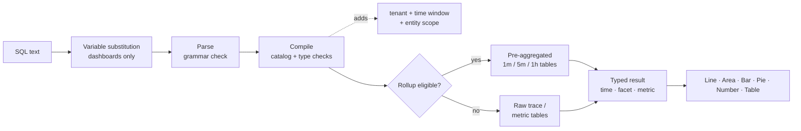

## Como consultar com SQL: os mecanismos de consulta {#how-to-query-with-sql-the-mechanics-of-querying}

Antes de usar qualquer ferramenta, é útil saber como ela funciona. Este documento mostra como explorar seus dados, explica o que acontece quando uma consulta é executada e aborda exemplos de consultas simples a complexas.

### Exploração de dados

A melhor maneira de usar o SQL é abrir o **Explorar** e experimentá-lo em seus próprios dados.

> **Dica**
>
> SQL é somente leitura. Ele não pode alterar ou excluir dados, e cada consulta tem escopo para seu locatário.

1. **Escolha um cliente** no alternador de locatário na parte superior do aplicativo; o SQL precisa de um único locatário.
2. Abra **Explorar**. A guia **Visual Builder** permite escolher **De** (uma entidade), **Agregado**, **Filtros**, **Faceta** e **Série Temporal**. O SQL gerado aparece abaixo de.
3. Alterne para a guia **SQL** para editar a consulta diretamente. O editor preenche automaticamente entidades, atributos e funções à medida que você digita.
4. Abra o painel **Guia de consulta** à direita para procurar entidades, tipos de atributos e consultas de exemplo. Clique em um exemplo para carregá-lo.
5. Clique em **Validar** para verificar uma consulta sem executá-la, ou **Executar** (⌘/Ctrl + Enter) para ver os resultados.

Comece digitando `FROM` e escolhendo uma entidade, depois adicione `SELECT` e um atributo:

```sql
FROM Transaction SELECT name, duration LIMIT 20
```

Esta é uma **consulta de eventos** básica. Ele retorna 20 solicitações de entrada, mostrando o nome da operação e a duração de cada uma.

Agora substitua os atributos por uma **agregação** e agrupe o resultado:

```sql
FROM Transaction SELECT count(*) FACET service
```

Isso conta solicitações por serviço, o que mostra quais serviços estão sendo relatados.

> **Importante**
>
> **Descubra antes de compilar.** A disponibilidade de atributos depende de como cada serviço é instrumentado. Execute as [consultas de descoberta](#101-data-discovery) em um novo locatário primeiro para ver quais serviços, hosts, atributos e métricas realmente contêm dados.

### Como uma consulta é executada

Quando você executa uma consulta, os Insights de capacidade de observação:

1. **Substitui variáveis**, substituindo `{{name}}` tokens pela seleção de variável de painel atual. Isso acontece no navegador, somente nos painéis.
2. **Analisa** o texto. Qualquer coisa fora da gramática SQL é rejeitada, incluindo ponto e vírgula, funções SQL brutas e subconsultas.
3. **Compila** a consulta. Ele mapeia cada atributo lógico (por exemplo, `urlPath`) para sua expressão armazenada e valida tipos e funções.
4. **Adiciona proteções obrigatórias**: seu locatário, a janela de tempo e o escopo fixo da entidade (por exemplo, `Transaction` significa somente intervalos de servidor).
5. **Rotas** consultas de série temporal qualificadas para tabelas **cumulativas** pré-agregadas. Isso é automático e os resultados correspondem aos dados brutos.
6. **Executa** a consulta com um tempo limite de 15 segundos e um orçamento de leitura de bytes e retorna colunas digitadas (tempo, faceta, métrica) que a interface do usuário renderiza.



### Formas de resultado

Cada consulta retorna uma das quatro formas. A forma decide quais gráficos fazem sentido.

| Forma | Como você consegue isso | Padrão `LIMIT` | Melhor visualização |
| --------------- | ---------------------------------------------------- | --------------- | ------------------ |
| **Outdoor** | Somente agregações, sem `FACET` e sem `TIMESERIES` | 1 | Número |
| **Faceta** | Agregados + `FACET` | 10 | Barra, Pizza, Tabela |
| **Série temporal** | Agregados + `TIMESERIES` (com ou sem `FACET`) | 5.000 linhas | Linha, Área, Barra |
| **Eventos** | Somente atributos brutos | 100 | Tabela |

<a id="time-window-precedence"></a>

### Prioridade da janela de tempo

| Onde a consulta é executada | Qual janela se aplica |
| --------------------------------- | ---------------------------------------------------------------------------------- |
| **Widget de painel** | O **seletor de hora** do painel. `SINCE`/`UNTIL` na consulta foram ignorados. |
| **Adicionar visualização de widget** | O seletor de horas dentro da caixa de diálogo **Adicionar widget**. |
| **Explorar** | O seletor de tempo global. `SINCE`/`UNTIL` são ignorados quando um intervalo do seletor está ativo. |
| **API sem um intervalo explícito** | `SINCE`/`UNTIL` na consulta, padronizando para a última hora. |

> **Nota**
>
> Como o seletor ganha nos painéis e em Explorar, este guia geralmente deixa `SINCE` fora das consultas do painel. Deve-se sempre definir um seletor de tempo para as consultas.
