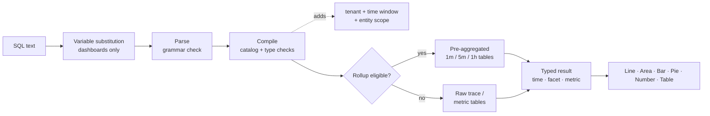

<a id="top"></a>

# Painel de insights de observação da Adobe/Documentação do query

**Adobe Observability Insights Query Language (SQL)** — consulte, gráfico e painel de telemetria nos Adobe Observability Insights.

|                |                                                                  |
| -------------- | ---------------------------------------------------------------- |
| **Aplica-se a** | Interface do usuário do Insights → **Explorar** e **Painéis** (painéis personalizados) |
| **Público-alvo** | Engenheiros, SREs e usuários avançados que conhecem SQL |

>[!TIP]
> Todo bloco de código marcado como `sql` é uma consulta SQL que você pode colar diretamente no **Explorar → SQL** ou nos **Painéis → Adicionar widget → SQL**.

## Mapa da documentação

| Seção | Doc | O que você vai aprender |
| --------------- | ----------------------------------------------------------------------------------- | ------------------------------------------------------------------------------------------- |
| **Introdução** | [1. Introdução ao SQL](#1-get-started-with-SQL-the-language-of-your-telemetry) | O que é SQL, o que você pode consultar, onde usá-lo, as regras básicas |
|                 | [2. Como consultar com SQL](#2-how-to-query-with-SQL-the-mechanics-of-querying) | Como explorar dados, como uma consulta é executada, exemplos trabalhados |
|                 | [3. Gráficos e painéis](#3-charts-and-dashboards-visualizing-your-data) | Como transformar consultas em gráficos e criar painéis passo a passo |
| **Referência** | [4. Referência SQL](#4-SQL-reference) | Cada cláusula, função e operador, com exemplos |
|                 | [5. Dicionário de dados](#5-data-dictionary) | Cada entidade e atributo que você pode consultar |
| **Tutoriais** | [6. Tutorial 1: Suas primeiras consultas](#6-tutorial-1-your-first-queries) | `SELECT`, `FROM`, `LIMIT`, agregações, hora, `TIMESERIES`, `WHERE`, `FACET` |
|                 | [7. Tutorial 2: Controle seus dados](#7-tutorial-2-control-your-data) | Valores únicos, mais recente/mais antigo, porcentagens, percentis, rótulos, curingas, ordenação |
|                 | [8. Tutorial 3: Avançar seu painel](#8-tutorial-3-advance-your-dashboarding) | Agregados condicionais, Apdex, taxas, histogramas, fórmulas, variáveis, seções |
|                 | [9. Tutorial 4: funções avançadas](#9-tutorial-4-advanced-functions) | `stddev`, `derivative`, classificado `latest`, participação do total, composição de span, descoberta de métrica |
| **Exemplos** | [10. Consultar guia](#10-query-cookbook) | Mais de 100 consultas prontas para uso por tópico (incluindo AEM) |
|                 | [11. Blueprints do painel](#11-dashboard-blueprints) | Dez painéis completos e complexos com consulta de cada widget |
| **Operar** | [12. Desempenho](#12-performance) | Rollups, orçamentos de consulta e como manter painéis rápidos |
|                 | [13. Solução de problemas](#13-troubleshooting) | Cada mensagem de erro, o que ela significa e como corrigi-la |
|                 | [14. Apêndice](#14-appendix) | Limites, formato de arquivo de exportação, folha de características de uma página |

&#x200B;# Introdução

## &#x200B;1. Introdução ao SQL: o idioma da telemetria

SQL é uma linguagem de consulta semelhante a SQL para seus dados do Observability Insights. É o mesmo idioma atrás de cada widget de painel personalizado e da página **Explorar**, para que você possa criar os modos de exibição de que sua equipe precisa.

O SQL funciona com **entidades**, que são exibições lógicas amigáveis, como `Transaction`, `Span` ou `CpuUtilization`. Você nunca consulta tabelas de armazenamento diretamente. O Observability Insights compila cada consulta SQL em uma consulta de warehouse segura e com parâmetros. Ele sempre mapeia essa consulta para seu locatário e a janela de tempo selecionada.

```sql
SELECT count(*) AS requests FROM Transaction TIMESERIES AUTO
```

### O que você pode fazer com o SQL

Usar SQL para:

- **Criar gráficos** de taxa de transferência, taxa de erro, latência, Apdex, CPU, memória, heap de JVM, disco e rede ao longo do tempo.
- **Responda a perguntas específicas**, como &quot;quais caminhos de URL no nível de publicação têm o pior p95?&quot; ou &quot;which downstream domain is failed?&quot; (que domínio downstream está falhando?)
- **Investigue incidentes** aprofundando de um KPI em solicitações individuais e IDs de rastreamento.
- **Crie painéis** com KPIs, tendências, tabelas, fórmulas, notas, cabeçalhos de seção e variáveis.
- **Criar perfil das cargas de trabalho do AEM** (Adobe Experience Manager) usando atributos Sling, JSP, JCR, dispatcher e GraphQL.

O SQL dá suporte a **consultas de eventos**, que retornam linhas de solicitação individuais, e **consultas agregadas**, que retornam totais, percentis, taxas, detalhamentos e séries de tempo.

>[!TIP]
> Os modelos em **Painéis → Criar painel** são criados inteiramente do SQL. Abra qualquer widget de modelo com o ícone de lápis para ver e aprender com sua consulta.

### O que você pode consultar

O SQL pode consultar quatro famílias de dados. A lista completa está no [Dicionário de dados](#5-data-dictionary).

| Família | Entidades | Perguntas típicas |
| ------------------------------------ | ------------------------------------------------------------------------------------------------------------------------------------------------------------------ | -------------------------------------------------------------------- |
| **Rastreamentos (APM)** | `Transaction` (solicitações de entrada), `AppRequest` (solicitações + consumidores de mensagem), `Span` (cada intervalo) | Taxa de transferência, latência, erros, Apdex, chamadas downstream, caminhos de código do AEM |
| **Métricas de host e tempo de execução preparadas** | `CpuUtilization`, `MemoryUtilization`, `LoadAverage5m`, `DiskUtilization`, `NetworkReceiveRate`, `JvmHeapUsed`, `JvmThreadCount`, `DispatcherRequestRate` e mais | Saturação, capacidade, integridade do JVM, carga do dispatcher |
| **Métricas genéricas** | `MetricGauge`, `MetricSum` | Qualquer métrica OpenTelemetry por nome, descoberta de métrica |
| **Composição de extensão pré-agregada** | `SpanBreakdown` | Quais operações secundárias compõem uma transação |

>[!NOTE]
> Logs, definições de alerta e relações de inventário não estão disponíveis.

### Onde usar SQL

| Onde | Como abri-lo | Para que serve |
| ----------------------- | ------------------------------------------------------------------------------ | ------------------------------------------------------------------------------------------------------------------------------------------------------------------------------------ |
| **Explorar** | Navegação à esquerda → **Explorar** | Ad hoc analysis Use o **Visual Builder** ou a guia **SQL**, **Validar** e **Executar** (⌘/Ctrl + Enter). Inclui consultas **Histórico** e **Salvas** e um painel **Guia de consulta**. |
| **Painéis** | Navegação à esquerda → **Painéis** → abrir ou criar um painel → **Adicionar widget** | Gráficos persistentes, KPIs e tabelas, combinados em painéis. |
| **Widgets de fórmula** | **Adicionar widget → Fórmula** | Combine 2 a 6 queries SQL com aritmética (taxas, espaço livre, taxas de gravação). |
| **Variáveis do painel** | **+ Variável → De uma consulta** | Preencha um seletor dos valores distintos de uma consulta SQL `FACET`. |
| **Inspeção de consulta** | Passe o mouse sobre um gráfico → inspecionar consulta | Veja o SQL por trás de um gráfico incorporado ou de painel. |

### Estrutura de consulta SQL

O SQL segue uma sintaxe baseada em cláusula. Essa consulta conta todas as solicitações de entrada na janela selecionada:

```sql
SELECT count(*) FROM Transaction
```

Estas são todas as cláusulas disponíveis:

```text
SELECT  function(attribute) [FILTER (WHERE condition)] [AS alias] [, ...]
        | attribute [AS alias] [, ...]
FROM    Entity
  [WHERE      condition [AND | OR ...]]
  [FACET      attribute [, attribute ...]]        -- up to 5
  [SINCE      n unit [AGO]]
  [UNTIL      NOW | n unit [AGO]]
  [TIMESERIES AUTO | MAX | n unit]
  [ORDER BY   alias [ASC | DESC]]
  [LIMIT      number]                              -- 1 to 5000
```

Estas são as regras que o SQL segue:

| Regra | Detalhes |
| ---------------------------- | ------------------------------------------------------------------------------------------------------------------------------------------------------------------------------------ |
| **Cláusulas obrigatórias** | `SELECT` e `FROM` são obrigatórios. Qualquer outra cláusula é opcional. Você pode começar com: `FROM Transaction SELECT count(*)` também é válido. |
| **Ordem da cláusula** | As cláusulas depois de `FROM` podem aparecer em qualquer ordem. Cada cláusula pode aparecer apenas uma vez. |
| **Tamanho da consulta** | Uma consulta deve ter 4 KB ou menos. |
| **Diferenciação de maiúsculas e minúsculas** | Palavras-chave, nomes de funções, nomes de entidades e nomes de atributos diferenciam maiúsculas de minúsculas **não**. Os valores da cadeia de caracteres **diferenciam maiúsculas de minúsculas** (`'Error'` ≠ `'error'`). |
| **Cadeias de caracteres** | Usar aspas simples: `WHERE status = 'Error'`. Para incluir uma aspa, dobre-a: `'O''Brien'`. Aspas duplas não são aceitas. |
| **Literais** | Sequências, números (incluindo negativos e decimais), `TRUE`, `FALSE`, `NULL`. |
| **Nomes de atributos** | Os nomes podem conter letras, dígitos, `_` e `.` (por exemplo, `http.statusCode`). Não é necessário usar backticks. |
| **Agregações vs. atributos** | Uma consulta seleciona atributos brutos (uma lista de eventos) ou agregações, nunca ambos. Para agrupar, use `FACET`. |
| **Janela de tempo** | O padrão é a última hora. O máximo é de 31 dias. Nos painéis e em Explorar, o **seletor de horas** define a janela (consulte [Janela de horas](#time-window-precedence)). |
| **Sem suporte** | Ponto e vírgula, comentários, subconsultas, junções, `SELECT *`, matemática entre atributos em `SELECT`, `HAVING`, `COMPARE WITH`. Consulte [O que o SQL não faz](#what-SQL-doesnt-do) para ver as alternativas. |

### Próximas etapas

- [Como consultar com SQL](#2-how-to-query-with-SQL-the-mechanics-of-querying): explore os dados e entenda como as consultas são executadas.
- [Gráficos e painéis](#3-charts-and-dashboards-visualizing-your-data): visualize seus resultados.
- [Tutorial 1: Suas primeiras consultas](#6-tutorial-1-your-first-queries): uma apresentação prática.
- [Referência SQL](#4-SQL-reference): sintaxe completa, cláusulas e funções.

[↑ Voltar ao início](#top)

## &#x200B;2. Como consultar com SQL: os mecanismos de consulta

Antes de usar qualquer ferramenta, é útil saber como ela funciona. Este documento mostra como explorar seus dados, explica o que acontece quando uma consulta é executada e aborda exemplos de consultas simples a complexas.

### Exploração de dados

A melhor maneira de usar o SQL é abrir o **Explorar** e experimentá-lo em seus próprios dados.

>[!TIP]
> SQL é somente leitura. Ele não pode alterar ou excluir dados, e cada consulta tem escopo para seu locatário.

1. **Escolha um cliente** no alternador de locatário na parte superior do aplicativo; o SQL precisa de um único locatário.
2. Abra **Explorar**. A guia **Visual Builder** permite escolher **De** (uma entidade), **Agregado**, **Filtros**, **Faceta** e **Série Temporal**. O SQL gerado aparece abaixo de.
3. Alterne para a guia **SQL** para editar a consulta diretamente. O editor preenche automaticamente entidades, atributos e funções à medida que você digita.
4. Abra o painel **Guia de consulta** à direita para procurar entidades, tipos de atributos e consultas de exemplo. Clique em um exemplo para carregá-lo.
5. Clique em **Validar** para verificar uma consulta sem executá-la, ou **Executar** (⌘/Ctrl + Enter) para ver os resultados.

Comece digitando `FROM` e escolhendo uma entidade, depois adicione `SELECT` e um atributo:

```sql
FROM Transaction SELECT name, duration LIMIT 20
```

Esta é uma **consulta de eventos** básica. Ele retorna 20 solicitações de entrada, mostrando o nome da operação e a duração de cada uma.

Agora substitua os atributos por uma **agregação** e agrupe o resultado:

```sql
FROM Transaction SELECT count(*) FACET service
```

Isso conta solicitações por serviço, o que mostra quais serviços estão sendo relatados.

>[!IMPORTANT]
> **Descubra antes de compilar.** A disponibilidade de atributos depende de como cada serviço é instrumentado. Execute as [consultas de descoberta](#101-data-discovery) em um novo locatário primeiro para ver quais serviços, hosts, atributos e métricas realmente contêm dados.

### Como uma consulta é executada

Quando você executa uma consulta, os Insights de capacidade de observação:

1. **Substitui variáveis**, substituindo `{{name}}` tokens pela seleção de variável de painel atual. Isso acontece no navegador, somente nos painéis.
2. **Analisa** o texto. Qualquer coisa fora da gramática SQL é rejeitada, incluindo ponto e vírgula, funções SQL brutas e subconsultas.
3. **Compila** a consulta. Ele mapeia cada atributo lógico (por exemplo, `urlPath`) para sua expressão armazenada e valida tipos e funções.
4. **Adiciona proteções obrigatórias**: seu locatário, a janela de tempo e o escopo fixo da entidade (por exemplo, `Transaction` significa somente intervalos de servidor).
5. **Rotas** consultas de série temporal qualificadas para tabelas **cumulativas** pré-agregadas. Isso é automático e os resultados correspondem aos dados brutos.
6. **Executa** a consulta com um tempo limite de 15 segundos e um orçamento de leitura de bytes e retorna colunas digitadas (tempo, faceta, métrica) que a interface do usuário renderiza.



### Formas de resultado

Cada consulta retorna uma das quatro formas. A forma decide quais gráficos fazem sentido.

| Forma | Como você consegue isso | Padrão `LIMIT` | Melhor visualização |
| --------------- | ---------------------------------------------------- | --------------- | ------------------ |
| **Outdoor** | Somente agregações, sem `FACET` e sem `TIMESERIES` | 1 | Número |
| **Faceta** | Agregados + `FACET` | 10 | Barra, Pizza, Tabela |
| **Série temporal** | Agregados + `TIMESERIES` (com ou sem `FACET`) | 5.000 linhas | Linha, Área, Barra |
| **Eventos** | Somente atributos brutos | 100 | Tabela |

<a id="time-window-precedence"></a>

### Prioridade da janela de tempo

| Onde a consulta é executada | Qual janela se aplica |
| --------------------------------- | ---------------------------------------------------------------------------------- |
| **Widget de painel** | O **seletor de hora** do painel. `SINCE`/`UNTIL` na consulta foram ignorados. |
| **Adicionar visualização de widget** | O seletor de horas dentro da caixa de diálogo **Adicionar widget**. |
| **Explorar** | O seletor de tempo global. `SINCE`/`UNTIL` são ignorados quando um intervalo do seletor está ativo. |
| **API sem um intervalo explícito** | `SINCE`/`UNTIL` na consulta, padronizando para a última hora. |

>[!NOTE]
> Como o seletor ganha nos painéis e em Explorar, este guia geralmente deixa `SINCE` fora das consultas do painel. Deve-se sempre definir um seletor de tempo para as consultas.

### Exemplos de consulta SQL

Aqui está um exemplo mais completo. Para esta consulta:

- Você escolhe `Transaction` como entidade.
- Você usa `SELECT` para calcular a duração do percentil 95.
- Você agrupa os resultados por serviço com `FACET`.
- Você usa `TIMESERIES AUTO` para plotar os dados em um intervalo dimensionado automaticamente.

```sql
FROM Transaction SELECT percentile(duration, 95) AS p95 FACET service TIMESERIES AUTO
```

Isso produz uma linha por serviço em um gráfico de linha, com os 10 serviços mais ocupados exibidos por padrão.

Clique em cada exemplo abaixo para expandi-lo.

<details>
<summary><strong>Consulta básica de solicitações de entrada</strong></summary>

Tempo médio de resposta, em milissegundos, de todas as solicitações de entrada:

```sql
SELECT average(duration) FROM Transaction
```

</details>

<details>
<summary><strong>Nomes de atributos que contêm pontos</strong></summary>

Nomes com pontos não precisam ser citados:

```sql
SELECT count(*) FROM Transaction WHERE http.statusCode >= 500 FACET http.route
```

</details>

<details>
<summary><strong>A consulta retornou várias colunas</strong></summary>

Vários agregados em uma query se tornam colunas em uma Tabela:

```sql
SELECT count(*) AS requests, average(duration) AS avgMs, percentile(duration, 95) AS p95, max(duration) AS maxMs FROM Transaction FACET service
```

</details>

<details>
<summary><strong>Agregados condicionais em uma passagem</strong></summary>

Total de erros e 5xx lado a lado:

```sql
SELECT count(*) AS total, count(*) FILTER (WHERE status = 'Error') AS errors, count(*) FILTER (WHERE http.statusCode >= 500) AS http5xx FROM Transaction FACET service
```

</details>

<details>
<summary><strong>Consultando uma métrica com curadoria</strong></summary>

Média de CPU por host ao longo do tempo:

```sql
SELECT average(value) AS cpu FROM CpuUtilization FACET host TIMESERIES AUTO
```

</details>

<details>
<summary><strong>Consultando qualquer métrica OpenTelemetry por nome</strong></summary>

Usar `MetricGauge` / `MetricSum` para métricas sem uma entidade com curadoria:

```sql
SELECT latest(value) AS bytesUsed FROM MetricSum WHERE metric = 'jvm.memory.used' FACET host, pool
```

</details>

<a id="what-SQL-doesnt-do"></a>

### O que o SQL não faz

O SQL é deliberadamente pequeno. Isso mantém as consultas seguras, rápidas e isoladas do locatário. Quando você precisar de um desses recursos, use a alternativa.

| Recurso | Status | Alternativa |
| ------------------------------------------- | ------------- | ------------------------------------------------------------------------------------------------------------ |
| `SELECT *` | Não suportado | Liste os atributos desejados: `SELECT timestamp, name, duration, traceId …`. |
| Combinação de atributos brutos e agregados | Não suportado | Use `FACET attr` ou `latest(attr)` / `earliest(attr)`. |
| Matemática em `SELECT` (`a - b`, `count(*) / 60`) | Não suportado | Widget (painéis) de **Fórmula**. |
| Associações e subconsultas | Não suportado | Widget de **Fórmula** ou dois widgets lado a lado. |
| `HAVING` | Não suportado | `ORDER BY alias` + `LIMIT`. |
| `COMPARE WITH` | Não suportado | Altere o seletor de hora ou coloque dois widgets em guias diferentes. |
| `FACET CASES` | Não suportado | Uma coluna `count(*) FILTER (WHERE …)` por caso (consulte [Tutorial 3](#83-group-values-into-cases-with-filter)). |
| `histogram()` | Não suportado | `FILTER` colunas em bucket (consulte [Tutorial 3](#84-build-a-latency-histogram)). |
| `uniques()` / `keyset()` | Não suportado | `FACET attr LIMIT n` lista valores distintos. Consultas de descoberta listam métricas e atributos preenchidos. |
| `RLIKE` (regex) | Não suportado | `LIKE` / `NOT LIKE` com os curingas `%` e `_`, ou `IN (…)`. |
| Comentários (`--`, `//`, `/* */`) | Não suportado | Coloque notas no título do widget ou em um widget **Texto**. |
| Datas absolutas em `SINCE` | Não suportado | Use o intervalo absoluto do seletor de tempo. |
| Conversão de tipo (`numeric()`, `string()`) | Não é necessário | Os atributos são digitados no catálogo. |

[↑ Voltar ao início](#top)

## &#x200B;3. Gráficos e painéis: visualização de dados

As consultas encontram as informações necessárias. Gráficos e painéis tornam essas informações úteis para a sua organização. Este documento mostra como os resultados de SQL se tornam gráficos e como criar, organizar e compartilhar painéis.

### Gráficos

Cada resultado SQL pode ser renderizado como um dos seis tipos de gráfico.

| Tipo de gráfico | Use-o para | Forma de consulta |
| --------------- | --------------------------------------------------- | ----------------------------------------------- |
| **Linha** | Tendências ao longo do tempo; uma linha por valor de faceta | Agregado + `TIMESERIES` |
| **Área** | Volume ao longo do tempo, como taxa de transferência por serviço | Agregado + `TIMESERIES` |
| **Barra** | Comparação de categorias; séries temporais esparsas | Agregado + `FACET` (± `TIMESERIES`) |
| **Pizza/Rosca** | Compartilhamento de um todo (combinação de códigos de status, tráfego por camada) | Uma agregação + `FACET`, poucos valores |
| **Número** | Um único KPI, com limites de cor opcionais | Outdoor (somente agregados) |
| **Tabela** | Várias agregações por grupo ou listas de eventos | Várias agregações + `FACET` ou atributos brutos |

Depois que um widget está em um painel, você pode:

- **Edite** sua consulta, título, tipo de gráfico e unidade (ícone de lápis).
- **Duplique** para criar uma variante, como o mesmo gráfico para outra camada.
- **Baixar CSV** das linhas atuais ou **PNG** na resolução 2×.
- **Arraste-o** pela alça da alça e **redimensione-o** do canto inferior direito.

### Painéis

Os gráficos funcionam bem por conta própria, mas os painéis os reúnem. Um painel é uma coleção de **guias** com nome e escopo de locatário. Cada guia é uma grade de 12 colunas de **widgets**.

| Conceito | Significado |
| --------------- | ------------------------------------------------------------------------------------------------------------------------------- |
| **Painel** | Uma coleção nomeada de 1 a 40 guias, armazenada no lado do servidor para o locatário selecionado. |
| **Guia** | Uma grade de widgets (até 200). Renomeie com o lápis, exclua-o com × e adicione um com **+**. Pelo menos uma guia deve permanecer. |
| **Widget** | Uma **única consulta**, uma **fórmula** ou um **texto** (uma observação ou um cabeçalho de seção recolhível). |
| **Variável** | Um seletor acima da grade. Seu valor é inserido como `{{name}}`. |
| **Seletor de hora** | A janela de cada widget no painel. |

### Criar um painel, passo a passo

#### Etapa 1: antes de começar

- **Selecione um único cliente** no alternador de locatário. **Criar painel** está desabilitado enquanto **Todas as contas** está selecionado. O SQL não pode ser executado no locatário de demonstração.
- **Funções.** Qualquer pessoa com acesso ao painel pode adicionar, editar e salvar widgets. Criar ou editar **variáveis** e inspecionar a consulta de um widget é limitado a **administradores da organização** e **superadministradores**.

#### Etapa 2: criar o painel

1. Abra **Painéis** na navegação à esquerda.
2. Clique em **Criar painel**.
3. Escolha um ponto inicial:

   | Opção | O que você ganha |
   | ---------------------------- | -------------------------------------------------------------------------------------------------------- |
   | **Criar um painel personalizado** | Um painel vazio com uma guia. |
   | **Noções básicas sobre o CPU** | Host e processo CPU (usuário/sistema/iowait/roubo), throughput, carga, Apdex. |
   | **Visão geral do All-in-One** | KPIs (volume, % de erro, Apdex, p95), pilhas de erro/tráfego, tabelas de memória/CPU, threads de JVM, operações lentas. |
   | **Principais Transações** | Apdex, p95 por operação, carga por host/CPU, transações mais lentas com IDs de rastreamento, detalhamento de erros HTTP. |

4. Insira um **nome** e confirme. A tela do painel é aberta.

#### Etapa 3: Conheça a tela

| Área | Controles |
| ---------------------------- | --------------------------------------------------------------------------------------------------------- |
| **Barra superior** | **Adicionar widget**, **Guia** (folha de características no aplicativo), **Importar**, **Exportar**, **Salvar**, seletor de tempo e atualizar |
| **Barra de variáveis** | Selo de locatário, um seletor por variável, **+ Variável** (administradores) |
| **Barra de guias** | Alternar guias; renomear (lápis), excluir (×), adicionar (+) |
| **Grade** | 12 colunas Arraste os widgets pela alça, redimensione a partir do canto (mínimo 2×2). |
| **Cabeçalho do widget** (ao passar o mouse) | Baixar CSV, Baixar PNG, Editar, Duplicar, Remover, arrastar alça |

>[!IMPORTANT]
> **Salvar é explícito.** Alterações de layout, novos widgets, guias e variáveis permanecem no navegador até que você clique em **Salvar**. O botão mostra _Salvando... → Salvo_, ou _Falha ao salvar_ (consulte [Solução de problemas](#13-troubleshooting)).

#### Etapa 4: adicionar um widget

Clique em **Adicionar widget**. A caixa de diálogo tem três modos: **Consulta única**, **Fórmula** e **Texto**. Ele também tem seu próprio seletor de tempo, para que você possa visualizar o widget em qualquer janela.

**Opção A: o Construtor (sem código)**

1. _(Opcional)_ **Comece com um auxiliar**: escolha uma das 57 predefinições, agrupadas como sinais dourados, APM, AEM, Transações, Rastreamentos e extensões, Infraestrutura, Editores, JVM e tempo de execução e Descoberta de dados. Uma predefinição preenche o título, a consulta, o tipo de gráfico e a unidade.
2. **Mostrar**: escolha `Count`, `Average`, `Percentile` (e seu nível), `Sum`, `Min`, `Max` ou `Unique count` e, em seguida, um atributo.
3. **de**: escolha a entidade.
4. **Filtro**: adicionar linhas de `attribute operator value` (`=`, `!=`, `>`, `<`, `>=`, `<=`, `LIKE`). Todas as linhas são combinadas com `AND`.
5. **Agrupar por**: escolha um atributo de faceta e **N principais** para manter apenas a série mais movimentada.
6. **Ao longo do tempo**: ativa o `TIMESERIES`, com um **a cada N minutos** tamanho de bucket.
7. Verifique o SQL gerado no formulário e clique em **Executar consulta**.

**Opção B: o editor SQL**

1. Alterne o **Construtor** para **SQL**. A edição de um widget existente sempre é aberta no SQL.
2. Digite ou cole uma consulta. O editor é preenchido automaticamente no catálogo em tempo real.
3. Use o painel **Guia de consulta** para procurar entidades, atributos e exemplos.
4. Clique em **Executar consulta**. Você verá que a consulta _`<Entity>`é válida_, uma visualização ao vivo e um resumo (`N rows · N time points · N groups`). Um aviso de _Série esparsa_ é exibido quando há menos de três pontos de tempo.

>[!TIP]
> O Construtor aborda as consultas mais comuns. Alternar para SQL para `apdex`, `percentage`, `rate`, `FILTER`, várias agregações, `OR`, `IN`, várias facetas ou `ORDER BY`.

#### Etapa 5: configurar a aparência

| Texto | Notas |
| --------------------- | ----------------------------------------------------------------------------------------------------------------------------------------------------------------------- |
| **Título** | Até 200 caracteres. Pode conter `{{variable}}` tokens. |
| **Tipo de gráfico** | `Line`, `Area`, `Bar`, `Pie / Donut`, `Number`, `Table`. Um tipo de gráfico é recomendado após cada execução até que você escolha um você mesmo. |
| **Unidade** | Opcional; até 40 caracteres (`ms`, `%`, `req/s`, `MB`, `bytes`). Deixe em branco para utilizar a unidade inferida (por exemplo `ms` para `duration`, `%` para `CpuUtilization`). |
| **Limites de cores** | Somente widgets de número. Até 10 bandas da forma _em ou acima `value` → Verde / Âmbar / Vermelho_. A banda mais bem sucedida ganha. |

#### Etapa 6: salvar o widget e, em seguida, o painel

**O widget Salvar** só está habilitado depois que uma execução retorna dados. Os novos widgets são 6 colunas × 3 linhas e são empacotados dois por linha. Organize-os e clique em **Salvar** na barra superior.

### Escolha o gráfico correto

| Forma de consulta | Melhor gráfico | Por que |
| ------------------------------------------------- | ------------------- | ---------------------------------------------- |
| Uma agregação, não `FACET`, não `TIMESERIES` | **Número** | Um único bloco de KPI; adicione limites. |
| Agregado + `TIMESERIES` | **Linha** / **Área** | Uma tendência; uma série por valor de faceta. |
| Agregado + `FACET` (poucos valores) | **Barra** / **Pizza** | Compara categorias; pizza por compartilhamento de um todo. |
| Várias agregações + `FACET` | **Tabela** | Cada agregação se torna uma coluna. |
| Atributos brutos | **Tabela** | Uma lista de eventos. |
| Agregar + `FACET` + `TIMESERIES` em dados esparsos | **Barra** | Lê melhor do que linhas fracas. |

Quando a linha única de um widget Número carrega um valor de texto (por exemplo, `latest(host)`), o widget o mostra como um subtítulo.

### Widgets de texto: notas e cabeçalhos de seção

**Adicionar widget → Texto**:

- **Observação**: texto simples (até 4.000 caracteres, linhas em branco preservadas). Use-o para links runbook, proprietários e definições de SLO. `{{variables}}` são renderizados.
- **Cabeçalho da seção**: marque _Transformar em cabeçalho de seção_. Ela expande a largura total e sua divisa recolhe todos os widgets abaixo dela até o próximo cabeçalho da seção. Use-o para agrupamentos como **PUBLISH**, **AUTHOR** e **DISPATCHER**.

>[!TIP]
> Os títulos de widget que terminam em `- PUBLISH` ou `- AUTHOR` obtêm uma dica de cor sutil, o que facilita a verificação dos painéis do AEM por camada.

### O seletor de hora

- Ele define a janela para o widget **a cada** e para as opções de variáveis orientadas por consulta.
- Ele substitui `SINCE` / `UNTIL` em consultas de widget.
- A janela máxima é de **31 dias**.
- `TIMESERIES AUTO` adapta o tamanho do seu bucket à janela.
- O subtítulo de cada widget mostra a janela realmente aplicada, por exemplo _Desde 1 hora atrás_.
- Os resultados são armazenados em cache por 30 segundos. Use o botão de atualização para forçar uma reexecução.

### Variáveis

As variáveis permitem que um painel sirva a vários contextos, como um serviço, ambiente ou limite por vez. Eles são abordados detalhadamente no [Tutorial 3](#87-make-dashboards-reusable-with-variables).

>[!WARNING]
> **Limitação conhecida na compilação atual:** `{{variables}}` funciona no widget **títulos** e **widgets de texto**. No widget **SQL**, eles são renderizados no painel, mas a pré-visualização **Adicionar widget** e a verificação **Salvar** do lado do servidor rejeitam o token `{{name}}` bruto com `Unexpected character '{'`. Até que isso seja corrigido, use valores literais em consultas de widget e use **Duplicar** para criar variantes.

### Widgets de fórmula

Uma fórmula combina 2-6 consultas SQL nomeadas aritmeticamente, por exemplo `(errors / total) * 100`. Use um quando um KPI precisar de mais de uma consulta, como uma taxa, espaço, uma soma de taxas ou uma taxa de gravação. Consulte [Tutorial 3](#86-combine-queries-with-formula-widgets).

### Compartilhar, exportar e importar

| Ação | O que faz |
| ------------- | ------------------------------------------------------------------------------------------------------------------------------------------------------------------------- |
| **Salvar** | Mantém o nome, as páginas, os widgets, a disposição e as variáveis. Cada consulta de widget é revalidada no lado do servidor; um widget inválido falha em todo o salvamento. |
| **Exportar** | Baixa `<dashboard-name>.json` (guias, widgets, variáveis). |
| **Importar** | Carrega uma exportação JSON **no painel aberto**, substituindo suas guias e variáveis. Depois clique em **Salvar**. Dica: primeiro crie um painel vazio e, em seguida, importe para ele. |
| **CSV / PNG** | Downloads por widget no cabeçalho do widget. |

>[!TIP]
> Exportar e importar permite que você controle a versão dos painéis no Git e promova um painel de um cliente para outro. O formato de arquivo está descrito no [Apêndice](#142-export-file-format).

### Dicas para desempenho de painéis e gráficos

- **Use tabelas para conjuntos de resultados grandes** em vez de barras ou linhas de várias séries.
- **Dividir painéis ocupados em guias.** Somente os widgets da aba visível são executados.
- **Sempre `LIMIT` consultas facetadas**, especialmente em atributos de alta cardinalidade, como `urlPath`, `traceId` e `jcr.path`.
- **Filtrar com antecedência** sobre atributos de baixa cardinalidade (`service`, `kind`, `status`).
- **Prefira`TIMESERIES AUTO`** a compartimentos pequenos fixos e evite `TIMESERIES MAX`, exceto por alguns minutos.
- **Criar tendências de longo alcance para rollups.** Consulte [Desempenho](#12-performance).

[↑ Voltar ao início](#top)

&#x200B;# Referência

## &#x200B;4. Referência SQL

Essa referência abrange sintaxe SQL, cláusulas, funções e operadores. Expanda cada entrada para obter detalhes e exemplos.

**Neste documento:** [Componentes de consulta](#41-query-components) · [Cláusulas obrigatórias](#42-required-clauses) · [Cláusulas opcionais](#43-optional-clauses) · [Funções de agregador](#44-aggregator-functions) · [Operadores e condições](#45-operators-and-conditions) · [Manipulação de tipo](#46-type-handling-blank-vs-null) · [SQL para SQL](#47-translate-sql-to-SQL) · [NRQL para SQL](#48-translate-nrql-to-SQL)

### 4.1 Componentes de query

```text
SELECT <select-item> [, <select-item> ...]
FROM   <Entity>
[WHERE      <condition>]
[FACET      <attribute> [, <attribute> ...]]          -- up to 5
[SINCE      <n> <unit> [AGO]]
[UNTIL      NOW | <n> <unit> [AGO]]
[TIMESERIES AUTO | MAX | <n> <unit>]
[ORDER BY   <alias-or-selected-name> [ASC | DESC]]
[LIMIT      <1..5000>]

<select-item> := <function>(<args>) [FILTER (WHERE <condition>)] [AS <alias>]
               | <attribute> [AS <alias>]
<unit>        := second | seconds | minute | minutes | hour | hours | day | days | week | weeks
```

>[!NOTE]
> As `--` anotações acima são somente documentação. O próprio SQL não aceita comentários.

### 4.2 Cláusulas obrigatórias

<details>
<summary><code>SELECT</code> — o que retornar</summary>

`SELECT` lista **atributos brutos** (uma consulta de evento) ou **funções de agregador** (uma consulta de agregação). Você não pode misturar os dois.

| Formulário | Exemplo | Resultado |
| ------------ | -------------------------------------------------- | ------------------------------------------------- |
| Atributos | `SELECT timestamp, name, duration` | Linhas de eventos individuais (padrão 100) |
| Agregados | `SELECT count(*), average(duration)` | Um valor por agregação (por faceta/período) |
| Com aliases | `SELECT count(*) AS requests` | Rótulo da coluna `requests` |
| Alias entre aspas | `SELECT percentile(duration, 95) AS 'p95 latency'` | Rótulo com espaços |

Lista de eventos:

```sql
SELECT timestamp, service, name, duration, status, traceId FROM Transaction WHERE status = 'Error' LIMIT 50
```

Vários agregados:

```sql
SELECT count(*) AS requests, average(duration) AS avgMs, max(duration) AS maxMs FROM Transaction
```

Regras:

- Não há suporte para `SELECT *`. Liste os atributos desejados.
- Não há suporte para correspondência entre atributos ou agregações (`sum(a) / count(*)`). Use um [widget de fórmula](#86-combine-queries-with-formula-widgets).
- A combinação de atributos e agregações falha com _atributos brutos não podem ser combinados com agregações; use FACET para agrupar resultados_.

</details>

<details>
<summary><code>FROM</code> — qual entidade consultar</summary>

`FROM` nomeia exatamente **uma** entidade do [Dicionário de dados](#5-data-dictionary). O nome da entidade não diferencia maiúsculas de minúsculas.

```sql
SELECT count(*) FROM Transaction
```

```sql
FROM Span SELECT count(*) FACET kind
```

Cada entidade tem um escopo fixo. Por exemplo, `Transaction` é sempre a extensão do servidor e `CpuUtilization` é sempre a métrica de CPU ocupado com `value` convertido em porcentagem. Você não pode consultar mais de uma entidade em uma única consulta. Para combinar entidades, use um [widget de Fórmula](#86-combine-queries-with-formula-widgets).

</details>

### 4.3 Cláusulas facultativas

<details>
<summary><code>AS</code> — rotular uma coluna</summary>

Use `AS` para dar um nome legível a uma agregação ou atributo. O alias se torna o cabeçalho da coluna, o rótulo da legenda e o nome que você referencia em `ORDER BY`.

```sql
SELECT count(*) AS requests, percentile(duration, 95) AS p95 FROM Transaction FACET service ORDER BY p95 DESC LIMIT 10
```

Use uma cadeia de caracteres entre aspas simples para rótulos com espaços:

```sql
SELECT percentile(duration, 95) AS 'p95 latency (ms)' FROM Transaction TIMESERIES AUTO
```

</details>

<details>
<summary><code>FACET</code> — resultados do grupo</summary>

`FACET` agrupa resultados por até **5** atributos, como SQL `GROUP BY`.

```sql
SELECT count(*) FROM Transaction FACET service, http.method, http.statusCode LIMIT 30
```

| Consulta | O que `LIMIT n` significa | Padrão |
| ---------------------------- | ----------------------------------------------------------------------------------------------------------------------------- | --------------------------------- |
| `FACET` sem `TIMESERIES` | Número de linhas | 10 |
| `FACET` com `TIMESERIES` | **N primeiras séries**, classificadas pela soma da primeira agregação em toda a janela. Cada período é mantido para essas séries. | Todas as séries (limitadas a 5.000 linhas) |

Séries cronológicas facetadas, top 5:

```sql
SELECT count(*) AS requests FROM Transaction FACET service TIMESERIES AUTO LIMIT 5
```

Os valores de facetas podem ser sequências ou números. Sequências de caracteres em branco formam seu próprio grupo. Excluí-los com `WHERE attr != ''`.

</details>

<details>
<summary><code>FILTER</code> — agregações condicionais</summary>

Anexe `FILTER (WHERE condition)` a qualquer agregação para calculá-la sobre um subconjunto de linhas. Isso permite comparar várias condições em uma única passagem.

```sql
SELECT count(*) AS total, count(*) FILTER (WHERE status = 'Error') AS errors, percentile(duration, 95) FILTER (WHERE http.method = 'GET') AS getP95 FROM Transaction FACET service LIMIT 20
```

`FILTER` não é permitido com `apdex`, `rate` ou `derivative`. `percentage` já assume sua própria condição.

</details>

<details>
<summary><code>LIMIT</code> — quantas linhas ou séries</summary>

`LIMIT` toma um inteiro positivo. Valores acima de 5.000 são fixados em 5.000.

| Forma do resultado | Padrão |
| ------------ | ---------- |
| Outdoor | 1 |
| Faceta | 10 |
| Séries cronológicas | 5.000 linhas |
| Eventos | 100 |

```sql
SELECT count(*) FROM Transaction FACET urlPath LIMIT 50
```

>[!TIP]
> Sempre defina um `LIMIT` em variáveis orientadas por consulta e em aspectos de alta cardinalidade (`urlPath`, `traceId`, `jcr.path`, `url`).

</details>

<details>
<summary><code>ORDER BY</code> — classificar resultados</summary>

`ORDER BY` classifica por um **alias ou atributo selecionado**. A direção padrão é `DESC`.

```sql
SELECT count(*) AS requests, percentile(duration, 95) AS p95 FROM Transaction FACET name ORDER BY p95 DESC LIMIT 20
```

| Forma do resultado | Ordem padrão |
| ----------------- | --------------------------------------------------------------------------- |
| Outdoor / faceta | Primeira agregação, `DESC` |
| Séries cronológicas | Hora, `ASC` |
| Eventos | Primeira coluna selecionada, `DESC` (assim, coloque `timestamp` primeiro como &quot;mais recente primeiro&quot;) |

Regras:

- A referência a algo que não está selecionado falha com _ORDER BY &#39;x&#39; deve fazer referência a um valor ou alias selecionado_.
- Não adicione `ORDER BY` a uma consulta `TIMESERIES`. Ele substitui a ordem de tempo que os gráficos precisam.

</details>

<details>
<summary><code>SINCE</code> — início da janela</summary>

`SINCE n unit [AGO]` define até que ponto a janela começa. Unidades: `second`, `minute`, `hour`, `day`, `week` (singular ou plural). `AGO` é opcional.

```sql
SELECT count(*) FROM Transaction SINCE 6 hours ago
```

- O padrão é `SINCE 1 hour ago`.
- A janela não pode exceder **31 dias** (_O intervalo de tempo não pode exceder 31 dias_).
- Datas absolutas (`SINCE '2026-01-01'`) e `TODAY` / `YESTERDAY` não são suportadas.

>[!IMPORTANT]
> Nos painéis e em Explorar, o **seletor de tempo substitui** `SINCE` e `UNTIL`. Consulte [Prioridade de janela de tempo](#time-window-precedence).

</details>

<details>
<summary><code>TIMESERIES</code> — plotar ao longo do tempo</summary>

`TIMESERIES` retorna uma linha por intervalo de tempo (por valor de faceta), que está pronta para gráficos de Linha, Área ou Barra.

| Formulário | Tamanho do bloco |
| ---------------------- | --------------------------------------------------------------------------------------------------------------------------------------------- |
| `TIMESERIES 5 minutes` | Exatamente o que você solicita (qualquer unidade) |
| `TIMESERIES AUTO` | Sobre a janela ÷ 120, arredondada para 1s / 5s / 10s / 15s / 30s / 1m / 5m / 10m / 15m / 30m / 1h / 6h / 12h / 1d. **Nunca abaixo de 2 minutos.** |
| `TIMESERIES MAX` | Intervalos de 1 segundo. Use somente em alguns minutos. |

`AUTO` compartimentos típicos:

| Janela | 1 h | 6 h | 24 h | 7 d | 30 d |
| ------ | ----- | ----- | ------ | --- | ---- |
| Balde | 2 min | 5 min | 15 min | 3 h | 6 h |

```sql
SELECT percentile(duration, 95) AS p95 FROM Transaction TIMESERIES AUTO
```

```sql
SELECT count(*) FROM Transaction TIMESERIES 1 hour SINCE 1 day ago
```

>[!TIP]
> Prefira `AUTO` nos painéis. Mantém cerca de 120 pontos o que quer que o seletor de tempo diga. Também evita linhas &quot;quebradas&quot; por host, pois as métricas do host são raspadas a cada 90 segundos.

</details>

<details>
<summary><code>UNTIL</code> — fim da janela</summary>

`UNTIL NOW` (padrão) ou `UNTIL n unit [AGO]`. Combine-o com `SINCE` para ver uma janela anterior:

```sql
SELECT count(*) AS yesterday FROM Transaction SINCE 2 days ago UNTIL 1 day ago
```

`SINCE` deve ser anterior a `UNTIL`. Caso contrário, a consulta falha com _SINCE deve ser anterior a UNTIL_.

</details>

<details>
<summary><code>WHERE</code> — filtrar linhas</summary>

`WHERE` mantém somente linhas que correspondem a uma condição. Combine condições com `AND`, `OR`, `NOT` e parênteses. Consulte [Operadores e condições](#45-operators-and-conditions).

```sql
SELECT count(*) FROM Transaction WHERE service = 'checkout' AND (status = 'Error' OR http.statusCode >= 500)
```

`WHERE` pode aparecer apenas uma vez. Coloque todas as condições nele.

</details>

### 4.4 Funções agregadoras

| Função | Argumentos | Devoluções | Funciona em |
| -------------------------------------- | ----------------------------------- | ---------------------- | ------------------------------------- |
| [`apdex`](#fn-apdex) | duração numérica, limite `T` | 0-1 | Rastrear entidades |
| [`average` / `avg`](#fn-average) | numérico | Mesma unidade que a entrada | Qualquer |
| [`count`](#fn-count) | `*` ou atributo | Número de linhas | Qualquer |
| [`derivative`](#fn-derivative) | numérico | Alteração por segundo | Qualquer um (precisa de `TIMESERIES`) |
| [`earliest`](#fn-latest) | qualquer [, classificação] | Valor do atributo | Qualquer |
| [`latest`](#fn-latest) | qualquer [, classificação] | Valor do atributo | Qualquer |
| [`max` / `min`](#fn-minmax) | qualquer | Mesma unidade que a entrada | Qualquer |
| [`percentage`](#fn-percentage) | `*` ou atributo, `WHERE` condição | % | Qualquer |
| [`percentile`](#fn-percentile) | numérico, nível `p` | Mesma unidade que a entrada | Qualquer |
| [`percentOfTotal`](#fn-percentoftotal) | numérico | % | Qualquer (não `TIMESERIES`) |
| [`rate`](#fn-rate) | contador numérico | Por segundo | Entidades contadoras (precisa de `TIMESERIES`) |
| [`stddev`](#fn-stddev) | numérico | Mesma unidade que a entrada | Qualquer |
| [`sum`](#fn-sum) | numérico | Mesma unidade que a entrada | Qualquer |
| [`uniqueCount`](#fn-uniquecount) | qualquer | Valores distintos | Qualquer |

<a id="fn-apdex"></a>

<details>
<summary><code>apdex(attribute, T)</code></summary>

Calcula uma pontuação de [Apdex](https://www.apdex.org/) de 0 (frustrado) a 1 (satisfeito), usando o limite `T` na unidade do atributo (milissegundos para `duration`).

| Balde | Condição | Peso |
| ---------- | ------------------------------------ | ------ |
| Satisfeito | `duration ≤ T` e não um erro | 1 |
| Tolerando | `T < duration ≤ 4T` e não um erro | 0.5 |
| Frustrado | `duration > 4T`, **ou qualquer erro** | 0 |

```sql
SELECT apdex(duration, 500) AS apdex FROM Transaction FACET service
```

- Funciona somente em entidades de rastreamento (`Transaction`, `AppRequest`, `Span`).
- `T` deve ser maior que 0. `FILTER` não é permitido.
- `apdex(duration, 500)` em `Transaction` é acelerado por rollup em janelas longas.

</details>

<a id="fn-average"></a>

<details>
<summary><code>average(attribute)</code> / <code>avg(attribute)</code></summary>

A média aritmética de um atributo numérico.

```sql
SELECT average(duration) AS avgMs FROM Transaction FACET service TIMESERIES AUTO
```

</details>

<a id="fn-count"></a>

<details>
<summary><code>count(*)</code> / <code>count(attribute)</code></summary>

- `count(*)` conta linhas.
- `count(attribute)` conta linhas nas quais o atributo é **não NULL**. Para atributos de cadeia de caracteres, os valores ausentes estão em branco (`''`) em vez de NULL, portanto, eles ainda são contados (consulte [Manuseio de tipo](#46-type-handling-blank-vs-null)).

```sql
SELECT count(*) AS requests, count(http.statusCode) AS withStatusCode FROM Transaction
```

</details>

<a id="fn-derivative"></a>

<details>
<summary><code>derivative(attribute)</code></summary>

A alteração por segundo de `average(attribute)` entre compartimentos consecutivos: (este compartimento - compartimento anterior) ÷ segundos do compartimento. O resultado pode ser negativo. Use-o em medidores para ver se um valor está crescendo ou diminuindo.

```sql
SELECT derivative(value) AS heapGrowthPerSec FROM JvmHeapUsed WHERE host = 'publish-1' TIMESERIES 5 minutes
```

- Requer `TIMESERIES`, e deve ser a agregação **only**. `FILTER` não é permitido.
- O primeiro bucket não tem antecessor.

</details>

<a id="fn-latest"></a>

<details>
<summary><code>latest(attribute [, rankAttribute])</code> / <code>earliest(…)</code></summary>

- `latest(attr)` retorna o valor da linha mais recente. `earliest(attr)` retorna o valor da linha mais antiga.
- Com um segundo argumento, a linha é escolhida por esse atributo em vez do tempo. `latest(traceId, duration)` retorna a ID de rastreamento da solicitação **mais lenta**. `earliest(traceId, duration)` retorna o mais rápido.

```sql
SELECT latest(value) AS current FROM MemoryUtilization FACET host
```

```sql
SELECT max(duration) AS slowestMs, latest(traceId, duration) AS slowestTrace FROM Transaction FACET name ORDER BY slowestMs DESC LIMIT 10
```

</details>

<a id="fn-minmax"></a>

<details>
<summary><code>max(attribute)</code> / <code>min(attribute)</code></summary>

O maior ou menor valor. Funciona com números, sequências e carimbos de data e hora.

```sql
SELECT min(duration) AS fastestMs, max(duration) AS slowestMs, max(timestamp) AS lastSeen FROM Transaction FACET service
```

</details>

<a id="fn-percentage"></a>

<details>
<summary><code>percentage(*, WHERE condition)</code></summary>

O compartilhamento de linhas que correspondem a `condition`, de 0 a 100.

```sql
SELECT percentage(*, WHERE status = 'Error') AS errorPct FROM Transaction FACET service TIMESERIES AUTO
```

```sql
SELECT percentage(*, WHERE duration > 2000) AS slowPct FROM Transaction
```

`percentage` tem sua própria condição, portanto, não leva `FILTER`.

</details>

<a id="fn-percentile"></a>

<details>
<summary><code>percentile(attribute, p)</code></summary>

O percentual p aproximado, onde `0 < p ≤ 100`. Use um `percentile` por nível.

```sql
SELECT percentile(duration, 50) AS p50, percentile(duration, 95) AS p95, percentile(duration, 99) AS p99 FROM Transaction TIMESERIES AUTO
```

p50, p95 e p99 em `Transaction` são acelerados por rollup em janelas longas.

</details>

<a id="fn-percentoftotal"></a>

<details>
<summary><code>percentOfTotal(attribute)</code></summary>

Compartilhamento de cada linha de faceta da **soma total** de um atributo numérico. As linhas somam até 100%.

```sql
SELECT sum(duration) AS totalMs, percentOfTotal(duration) AS shareOfTime FROM Transaction FACET name LIMIT 15
```

Não permitido com `TIMESERIES`.

</details>

<a id="fn-rate"></a>

<details>
<summary><code>rate(attribute)</code></summary>

A taxa por segundo de um **contador cumulativo**. Em cada compartimento, `rate` obtém a maior leitura de contador por série e a diferencia do compartimento anterior. As reinicializações de contador são liberadas em 0, e o primeiro bucket é 0.

```sql
SELECT rate(value) AS bytesPerSec FROM NetworkReceiveRate FACET host TIMESERIES AUTO
```

- Funciona somente em entidades de contador (marcado ✔ no [Dicionário de dados](#53-curated-metric-entities)).
- Requer `TIMESERIES`, e deve ser a agregação **only**. `FILTER` não é permitido.

>[!WARNING]
> Sempre `FACET host`, ou filtrar para um único host. Um `rate()` não facetado em vários hosts compara contadores de hosts diferentes e produz números sem sentido. Os contadores de disco são por dispositivo, portanto, `FACET host, device` é o mais preciso.

</details>

<a id="fn-stddev"></a>

<details>
<summary><code>stddev(attribute)</code></summary>

O desvio padrão da amostra. Use-o com `average` para avaliar a consistência da latência.

```sql
SELECT average(duration) AS avgMs, stddev(duration) AS stddevMs FROM Transaction FACET name LIMIT 20
```

</details>

<a id="fn-sum"></a>

<details>
<summary><code>sum(attribute)</code></summary>

O total de um atributo numérico.

```sql
SELECT sum(callCount) AS calls FROM SpanBreakdown FACET segment LIMIT 20
```

</details>

<a id="fn-uniquecount"></a>

<details>
<summary><code>uniqueCount(attribute)</code></summary>

O número **exato** de valores distintos.

```sql
SELECT uniqueCount(host) AS hosts, uniqueCount(traceId) AS traces FROM Transaction FACET service
```

</details>

Acesso rápido às restrições de função:

| Restrição | Funções |
| ------------------------------------- | ----------------------------------------------------------------------------------------- |
| Atributo numérico obrigatório | `average`, `sum`, `percentile`, `stddev`, `percentOfTotal`, `rate`, `derivative`, `apdex` |
| Nenhum `FILTER (WHERE …)` | `apdex`, `rate`, `derivative`, `percentage` |
| Requer `TIMESERIES`, somente agregação | `rate`, `derivative` |
| Não com `TIMESERIES` | `percentOfTotal` |
| Rastrear somente entidades | `apdex` |
| Somente entidades contadoras | `rate` |

### 4.5 Operadores e condições

| Operador | Significado | Exemplo |
| ------------------------- | -------------------------------------------------------------------------- | ---------------------------------------- |
| `=` | Igual | `status = 'Error'` |
| `!=`, `<>` | Diferente de | `kind != 'Internal'` |
| `<`, `<=`, `>`, `>=` | Comparação | `http.statusCode >= 500` |
| `LIKE` | Correspondência curinga: `%` = qualquer caractere, `_` = um caractere. Diferenciação de maiúsculas e minúsculas. | `urlPath LIKE '/content/%'` |
| `NOT LIKE` | Curinga negado | `urlPath NOT LIKE '%.css'` |
| `IN (…)` | Corresponde a qualquer um dos valores 1-100 | `service IN ('checkout', 'cart')` |
| `NOT IN (…)` | Não corresponde a nenhum dos valores | `http.method NOT IN ('OPTIONS', 'HEAD')` |
| `IS NULL` / `IS NOT NULL` | Verificação nula | `http.statusCode IS NOT NULL` |
| `AND`, `OR`, `NOT` | Lógica | `NOT (status = 'Ok')` |
| `( … )` | Agrupamento | `(a = 1 OR b = 2) AND c = 3` |

```sql
SELECT count(*) FROM Transaction WHERE (status = 'Error' OR duration > 2000) AND NOT host LIKE '%dispatcher%' AND http.method IN ('GET', 'POST')
```

>[!WARNING]
> `attr = NULL` é um erro. Usar `attr IS NULL`.

### 4.6 Manuseio de tipo: em branco vs. NULO

Cada atributo tem um tipo no catálogo: `string`, `number`, `boolean` ou `timestamp`. As funções de verificação de tipo SQL em relação a ele (por exemplo, `average(service)` foi rejeitado). Nenhuma função de conversão do tipo é necessária ou está disponível.

>[!IMPORTANT]
> **Em branco vs. NULL.** A maioria dos atributos de cadeia de caracteres vem de mapas de atributos OpenTelemetry, onde uma chave _ausente_ é lida como uma cadeia de caracteres vazia `''`, não `NULL`. Para manter somente os spans que possuem um atributo, use **`attr != ''`** em vez de `IS NOT NULL`. Atributos numéricos como `http.statusCode` são genuinamente `NULL` quando ausentes, então `IS NOT NULL` funciona para eles.

```sql
SELECT count(*) AS jcrCalls FROM Span WHERE jcr.operation != '' FACET jcr.operation
```

### 4.7 Traduzir SQL para SQL

| SQL | SQL |
| ------------------------------------------------------------ | ------------------------------------------------------------------- |
| `WHERE ts > now() - INTERVAL 1 HOUR` | Nada; o seletor de hora (ou `SINCE 1 hour ago`) define a janela |
| `GROUP BY service` | `FACET service` |
| `GROUP BY toStartOfInterval(ts, INTERVAL 5 MINUTE), service` | `FACET service TIMESERIES 5 minutes` |
| `quantile(0.95)(duration)` | `percentile(duration, 95)` |
| `countIf(status = 'Error')` | `count(*) FILTER (WHERE status = 'Error')` |
| `100 * countIf(x) / count()` | `percentage(*, WHERE x)` |
| `count(DISTINCT host)` | `uniqueCount(host)` |
| `argMax(traceId, duration)` | `latest(traceId, duration)` |
| `x / sum(x) OVER ()` | `percentOfTotal(x)` |
| `ORDER BY p95 DESC LIMIT 20` | `ORDER BY p95 DESC LIMIT 20` |
| `HAVING count() > 100` | _Sem suporte_. Classificar e `LIMIT` em vez disso. |
| `JOIN` / subconsulta | _Sem suporte_. Use um widget **Fórmula**. |
| `CASE WHEN` | _Sem suporte_. Use `FILTER` colunas ou `WHERE … LIKE` + `FACET`. |

### 4.8 Importação do painel existente para o Insights

Se você conhece a consulta existente, veja a seguir os detalhes da migração

| Consulta Existente | SQL | Notas |
| ------------------------------------------- | ------------------------------------------------------------------ | ------------------------------------------------------------ |
| `FROM Transaction SELECT count(*)` | Igual | Há suporte para `FROM`-primeira ordem |
| `SINCE 1 day ago` | Igual | Ignorado nos painéis; o seletor vence |
| `TIMESERIES AUTO` / `MAX` / `5 minutes` | Igual | `AUTO` andar é 2 minutos |
| `FACET appName` | `FACET appName` / `FACET service` |                                                              |
| `percentage(count(*), WHERE error IS true)` | `percentage(*, WHERE status = 'Error')` |                                                              |
| `filter(count(*), WHERE …)` | `count(*) FILTER (WHERE …)` | Formulário padrão SQL |
| `apdex(duration, t: 0.5)` | `apdex(duration, 500)` | `duration` está em **ms** |
| `latest(x)` / `earliest(x)` | Igual | Além de um formulário classificado: `latest(x, rankAttr)` |
| `uniqueCount(x)` | Igual | Exato |
| `rate(count(*), 1 minute)` | `count(*)` com `TIMESERIES 1 minute` | O SQL `rate()` é somente para contadores |
| `derivative(x, 1 minute)` | `derivative(x)` + `TIMESERIES` | Por segundo |
| `uniques(x)` | `count(*) … FACET x LIMIT n` |                                                              |
| `keyset()` / `SHOW EVENT TYPES` | [Consultas de descoberta](#101-data-discovery) ou o painel Guia de consulta |                                                              |
| `histogram(duration, …)` | `FILTER` compartimentos | Ver [Tutorial 3](#84-build-a-latency-histogram) |
| `FACET CASES (…)` | `FILTER` colunas | Ver [Tutorial 3](#83-group-values-into-cases-with-filter) |
| `COMPARE WITH 1 week ago` | Não suportado | Altere o seletor de hora ou use `SINCE … UNTIL …` por meio da API |
| `RLIKE` | `LIKE` / `IN` |                                                              |
| Matemática em `SELECT` / agregação aninhada | Widget de **Fórmula** |                                                              |
| `WITH TIMEZONE`, `EXTRAPOLATE`, `SLIDE BY` | Não suportado |                                                              |

[↑ Voltar ao início](#top)

## &#x200B;5. Dicionário de dados

Isso é cada entidade e atributo que você pode consultar. O catálogo ao vivo, com descrições, também está no painel **Guia de consulta** em Explorar e na caixa de diálogo Adicionar widget.

### 5.1 Rastrear entidades

| Entidade | Contém | Escopo fixo | Rollups |
| ------------- | --------------------------------------------------------- | ---------------------------- | --------------------------------------------- |
| `Transaction` | Solicitações de entrada do servidor | `kind = Server` | 1m / 5m / 1h ([Desempenho](#12-performance)) |
| `AppRequest` | Solicitações do consumidor de mensagens **e** do servidor de entrada | `kind IN (Server, Consumer)` | — |
| `Span` | Cada span (servidor, cliente, produtor, consumidor, interno) | — | — |

<details open>
<summary><strong>Atributos de rastreamento</strong> (idênticos em todas as três entidades)</summary>

| Atributo | Tipo | Descrição |
| --------------------------------------------------- | ----------- | ----------------------------------------------------------------------------------------------- |
| `timestamp` | carimbo de data e hora | Hora de início da extensão |
| `traceId`, `spanId`, `parentSpanId` | string | Identificadores (extensões raiz têm `parentSpanId = ''`) |
| `name` | string | Nome da operação ou transação |
| `kind` | string | `Server`, `Client`, `Producer`, `Consumer`, `Internal` |
| `service` | string | Nome do serviço emissor |
| `serviceKey` | string | Identidade de serviço efetiva (retorna para `appName` quando `service` está em branco ou é um pai grosso) |
| `appName` | string | Nome do aplicativo do Observability Insights |
| `appInstance` | string | Identidade por instância: prefixo do host de criação/publicação, nome do aplicativo e serviço |
| `hostTierPrefix` | string | Nome do host truncado em seu sufixo de função `author` / `publish` / `dispatcher` |
| `duration` | número (ms) | Duração da extensão em milissegundos |
| `status` | string | `Ok`, `Error`, `Unset` |
| `statusMessage` | string | Descrição do status |
| `host` | string | Nome do host |
| `environment` | string | Ambiente de implantação |
| `region` | string | Região da nuvem |
| `cloud.provider` | string | AWS / AZURE / GCP |
| `http.method` | string | `GET`, `POST`, ... |
| `http.statusCode` | número | Status de resposta HTTP |
| `http.route` | string | Modelo de roteiro normalizado |
| `url` | string | URL completo |
| `urlPath` | string | Parte do caminho da URL (`/content/site/en.html`) |
| `externalDomain` | string | Domínio de um URL de saída (use em extensões de cliente) |
| `peer.service` | string | Serviço downstream chamado |
| `db.system`, `db.operation`, `db.namespace` | string | Tecnologia, operação e esquema do banco de dados |
| `messaging.system`, `messaging.destination` | string | Kafka, RabbitMQ, ... e tópico ou fila |
| `rpc.system`, `rpc.method` | string | gRPC e semelhante |
| `error.type` | string | Exceção ou tipo de erro |
| `sling.script`, `sling.servlet`, `sling.requestUri` | string | Detalhes do AEM Sling |
| `jsp.path` | string | JSP do AEM executado |
| `jcr.operation`, `jcr.path` | string | Operação e caminho do repositório JCR no AEM |
| `graphql.operation` | string | Nome da operação do GraphQL |

</details>

### 5.2 Entidades métricas genéricas

| Entidade | Contém |
| ------------- | -------------------------------------------------- |
| `MetricGauge` | Toda amostra de medidor point-in-time OpenTelemetry |
| `MetricSum` | Toda amostra de soma cumulativa ou delta OpenTelemetry |

Use-as para **descoberta** ou para métricas que não tenham uma entidade com curadoria: `WHERE metric = 'jvm.gc.duration'`.

<details open>
<summary><strong>Atributos da métrica</strong> (compartilhados por todas as entidades de métrica)</summary>

| Atributo | Tipo | Descrição |
| ----------------------------------------------------------------------- | --------- | ------------------------------------------------------- |
| `timestamp` | carimbo de data e hora | Hora da amostra |
| `metric` | string | Nome da métrica OpenTelemetry |
| `value` | número | Exemplo de valor (convertido em entidades com curadoria; veja abaixo) |
| `unit` | string | Unidade de métrica |
| `service`, `appName`, `host`, `environment`, `region`, `cloud.provider` | string | Identidade do recurso |
| `state` | string | Modo CPU ou estado de memória |
| `cpu`, `device`, `direction`, `mountpoint` | string | Por CPU, por dispositivo, direção de I/O, sistema de arquivos |
| `pool` | string | Pool de memória JVM ou pool de conexão |
| `topic` | string | Tópico Kafka |
| `process.pid`, `process.name`, `process.owner` | string | Identidade do processo |

</details>

### 5.3 Entidades de métrica preparadas

Cada entidade com curadoria envolve uma métrica OpenTelemetry com o filtro e a conversão de unidade corretos, portanto, `value` já é significativo. **Contador** entidades (✔) mantêm totais cumulativos. Consulte-os com `rate(value)` e `TIMESERIES`.

| Entidade | `value` significa | Unidade | Contador | Notas |
| ------------------------------------------------------------------------------ | ----------------------------------- | --------- | ------- | -------------------------------------------- |
| `CpuUtilization` | CPU ocupado | % |         | Acúmulo de 1 minuto para `average(value)` por host |
| `CpuUserPercent` / `CpuSystemPercent` / `CpuIowaitPercent` / `CpuStealPercent` | Tempo por modo do CPU | % |         |                                              |
| `MemoryUtilization` | Memória usada | % |         | Acúmulo de 1 minuto para `average(value)` |
| `LoadAverage1m` / `LoadAverage5m` / `LoadAverage15m` | Média de carga | — |         |                                              |
| `LoadAverageWithFallback` | 5 m de carga, recuando para 1 m | — |         |                                              |
| `DiskUtilization` | Disco usado por montagem | % |         | Faceta por `mountpoint` |
| `DiskFreeBytes` | Sistema de arquivos raiz livre | bytes |         |                                              |
| `DiskReadRate` / `DiskWriteRate` | Taxa de transferência de disco | bytes/s | ✔ |                                              |
| `DiskReadOpsRate` / `DiskWriteOpsRate` | IOPS de disco | ops/s | ✔ |                                              |
| `NetworkReceiveRate` / `NetworkTransmitRate` | taxa de transferência eth0 | bytes/s | ✔ |                                              |
| `NetworkReceiveRateAllDevices` / `NetworkTransmitRateAllDevices` | Todos os dispositivos | bytes/s | ✔ |                                              |
| `NetworkIoRate` | Todas as direções e dispositivos combinados | bytes/s | ✔ |                                              |
| `NetworkReceiveErrorRate` / `NetworkTransmitErrorRate` | Erros de rede | erros/s | ✔ |                                              |
| `NetworkReceivePacketRate` / `NetworkTransmitPacketRate` | Pacotes | pacotes/s | ✔ |                                              |
| `ProcessCpuUtilization` | CPU por processo | % |         | Faceta por `process.name` |
| `ProcessMemoryUsage` | Memória por processo | MB |         |                                              |
| `JvmHeapUsed` / `JvmHeapLimit` | heap de JVM | MB |         | Relatado por pool de memória |
| `JvmThreadCount` | Threads JVM | — |         |                                              |
| `JvmCpuRecentUtilization` | CPU do processo JVM | % |         | Acúmulo de 1 minuto |
| `DispatcherRequestRate` | Solicitações HTTP do AEM Dispatcher | solic./s | ✔ |                                              |

>[!NOTE]
> As métricas de memória JVM são relatadas **por pool de memória**, portanto, `average(value)` em `JvmHeapUsed` / `JvmHeapLimit` médias entre pools. Use `FACET host, pool` para uma exibição exata por pool.

### 5.4 `SpanBreakdown`: composição de transação pré-agregada

`SpanBreakdown` contém a composição de intervalo filho por minuto de cada transação. É calculado na assimilação, portanto é barato consultar.

| Atributo | Tipo | Descrição |
| --------------- | --------- | ---------------------------------------------------------------------- |
| `timestamp` | carimbo de data e hora | Classificação de um minuto |
| `service` | string | Serviço |
| `rootOperation` | string | Nome da transação pai |
| `segment` | string | Nome da extensão secundária |
| `callCount` | número | Chamadas deste segmento no bucket |
| `avgDurationMs` | número | Duração média do segmento no bucket (defina a unidade para `ms` manualmente) |

[↑ Voltar ao início](#top)

&#x200B;# Tutoriais

## &#x200B;6. Tutorial 1: Suas primeiras consultas

Bem-vindo ao SQL. Neste tutorial, você escreverá suas primeiras consultas, controlará a janela de tempo, plotará tendências, filtrará e agrupará resultados e colocará seu primeiro gráfico em um painel. Cada etapa se baseia na anterior.

**Neste tutorial:** [Antes de começar](#before-you-begin) · [6.1 Eventos de consulta](#61-query-events-with-select-from-and-limit) · [6.2 Agregação](#62-aggregate-your-data) · [6.3 Várias agregações](#63-return-several-aggregates-at-once) · [6.4 Janela de tempo](#64-set-the-time-window) · [6.5 SÉRIES TEMPORAIS](#65-plot-trends-with-timeseries) · [6.6 ONDE](#66-filter-with-where) · [6.7 FACET](#67-group-with-facet) · [6.8 Salvar em um painel](#68-save-your-query-to-a-dashboard)

### Antes de começar

- Você precisa de acesso aos Insights de observação e, pelo menos, um locatário do cliente que envia rastreamentos ou métricas.
- Selecione esse **cliente** no alternador de locatário. O SQL não é executado enquanto **Todas as contas** estiverem selecionadas.
- Abra **Explorar** e alterne para a guia **SQL**. Use **Executar** (⌘/Ctrl + Enter) após cada consulta.

### 6.1 Consultar eventos com `SELECT`, `FROM` e `LIMIT`

Toda consulta precisa de duas cláusulas: `SELECT` diz o que retornar e `FROM` diz qual entidade ler. Iniciar com solicitações de entrada:

```sql
SELECT timestamp, service, name, duration FROM Transaction
```

Esta é uma **consulta de evento**. Cada linha é uma solicitação. Sem um `LIMIT`, você obtém até 100 linhas. Solicitar menos:

```sql
SELECT timestamp, service, name, duration FROM Transaction LIMIT 10
```

As linhas são classificadas pela primeira coluna, em ordem decrescente, portanto, colocar `timestamp` primeiro fornece as solicitações mais recentes na parte superior.

>[!NOTE]
> O SQL não tem `SELECT *`. Os atributos de listagem mantêm os resultados pequenos e legíveis. O [Dicionário de dados](#5-data-dictionary) e o preenchimento automático no editor mostram o que está disponível.

### 6.2 Agregar os dados

A maioria dos painéis não mostra eventos individuais. Eles as resumem. Substitua os atributos por uma **função agregadora**:

```sql
SELECT count(*) FROM Transaction
```

Esse é o número de solicitações de entrada na janela. Tente mais alguns:

```sql
SELECT average(duration) FROM Transaction
```

```sql
SELECT max(duration) FROM Transaction
```

```sql
SELECT uniqueCount(host) FROM Transaction
```

### 6.3 Retornar vários agregados de uma vez

Separe as agregações com vírgulas e nomeie cada uma com `AS`:

```sql
SELECT count(*) AS requests, average(duration) AS avgMs, max(duration) AS maxMs FROM Transaction
```

>[!TIP]
> Os aliases se tornam cabeçalhos de coluna e rótulos de legenda, e são o que você menciona em `ORDER BY`. Aprenda a nomear cada agregado.

### 6.4 Definir a janela de tempo

Por padrão, uma consulta abrange a **última hora**. Use `SINCE` para retroceder:

```sql
SELECT count(*) AS requests FROM Transaction SINCE 1 day ago
```

Use `UNTIL` para encerrar a janela no passado. Isso conta o tráfego de ontem, de 48 a 24 horas atrás:

```sql
SELECT count(*) AS requests FROM Transaction SINCE 2 days ago UNTIL 1 day ago
```

As unidades podem ser `second`, `minute`, `hour`, `day` ou `week`. A janela pode ter no máximo 31 dias.

>[!IMPORTANT]
> No **Explorar** e nos **painéis**, o **seletor de horas** na parte superior da página controla a janela e substitui `SINCE`/`UNTIL`. Para observar outro ponto, altere o seletor. O restante deste guia deixa `SINCE` fora das consultas do painel por esse motivo.

### 6.5 Plotar tendências com `TIMESERIES`

Adicione `TIMESERIES` para transformar um único número em uma linha ao longo do tempo:

```sql
SELECT count(*) AS requests FROM Transaction TIMESERIES AUTO
```

`AUTO` escolhe um tamanho de balde para que o gráfico tenha cerca de 120 pontos (2 minutos para uma janela de 1 hora, 15 minutos para 24 horas). Também é possível definir o bucket explicitamente:

```sql
SELECT average(duration) AS avgMs FROM Transaction TIMESERIES 5 minutes
```

### 6.6 Filtrar com `WHERE`

`WHERE` mantém apenas as linhas importantes para você. Contar somente solicitações com falha:

```sql
SELECT count(*) AS errors FROM Transaction WHERE status = 'Error'
```

Combinar condições com `AND`, `OR` e parênteses:

```sql
SELECT count(*) AS slowOrFailed FROM Transaction WHERE service = 'checkout' AND (status = 'Error' OR duration > 2000)
```

Usar `LIKE` com `%` para correspondências parciais:

```sql
SELECT count(*) AS contentRequests FROM Transaction WHERE urlPath LIKE '/content/%'
```

>[!NOTE]
> Os valores da cadeia de caracteres diferenciam maiúsculas de minúsculas e usam aspas simples: `'Error'`, não `"Error"` ou `'error'`. Substitua `checkout` com um serviço de seu locatário. A próxima etapa mostra como listá-los.

### Grupo 6.7 com `FACET`

`FACET` resultados de grupos, como `GROUP BY` de SQL. Liste seus serviços e o grau de ocupação de cada um:

```sql
SELECT count(*) AS requests FROM Transaction FACET service
```

Uma consulta facetada retorna os 10 grupos principais por padrão. Use `LIMIT` para ver mais:

```sql
SELECT count(*) AS requests, average(duration) AS avgMs FROM Transaction FACET service LIMIT 50
```

Combine `FACET` e `TIMESERIES` para obter uma linha por grupo:

```sql
SELECT count(*) AS requests FROM Transaction FACET service TIMESERIES AUTO LIMIT 5
```

Aqui, `LIMIT 5` mantém as cinco séries mais ocupadas.

### 6.8 Salvar a consulta em um painel

1. Abra **Painéis → Criar painel → Criar um painel personalizado** e nomeie-o _Meu primeiro painel_.
2. Clique em **Adicionar widget**, escolha **Consulta única** e alterne para **SQL**.
3. Cole a consulta da etapa 6.7 e clique em **Executar consulta**.
4. Defina o **Título** como _Solicitações por serviço_ e escolha o tipo de gráfico **Linha**.
5. Clique em **Salvar widget** e depois em **Salvar** na barra superior.

Você criou seu primeiro painel.

### O que vem a seguir

- [Tutorial 2: Controlar seus dados](#7-tutorial-2-control-your-data) abrange valores exclusivos, porcentagens, percentis, curingas e classificação.
- A [referência SQL](#4-SQL-reference) tem todas as cláusulas e funções.

[↑ Voltar ao início](#top)

## &#x200B;7. Tutorial 2: controlar seus dados

Neste tutorial, você aprenderá as funções e cláusulas que transformam contagens brutas em respostas: contagens distintas, valores mais recentes, porcentagens, percentis, curingas, classificação e agrupamento multidimensional.

**Neste tutorial:** [7.1 uniqueCount](#71-count-distinct-values-with-uniquecount) · [7.2 latest/first](#72-find-the-latest-and-earliest-values) · [7.3 percentage](#73-calculate-percentages) · [7.4 percentile](#74-understand-latency-with-percentile) · [7.5 Labels](#75-make-results-readable-with-labels) · [7.6 Curingas e listas](#76-match-patterns-and-lists) · [7.7 Sorting](#77-sort-and-rank-with-order-by) · [7.8 Várias facetas](#78-group-by-several-attributes) · [7.9 Past windows](#79-look-at-a-past-window)

### 7.1 Contar valores distintos com `uniqueCount`

Quantos hosts e rastreamentos distintos cada serviço tem?

```sql
SELECT uniqueCount(host) AS hosts, uniqueCount(traceId) AS traces FROM Transaction FACET service
```

`uniqueCount` é exato, não uma estimativa.

Para **listar** os próprios valores distintos (o que o NRQL chama `uniques()`), faceta no atributo:

```sql
SELECT count(*) AS requests FROM Transaction FACET host LIMIT 100
```

### 7.2 Localizar os valores mais recentes e mais antigos

`latest(attr)` retorna o valor mais recente e `earliest(attr)` o mais antigo. Elas são úteis para tabelas de &quot;estado atual&quot;:

```sql
SELECT latest(value) AS currentCpu FROM CpuUtilization FACET host
```

```sql
SELECT earliest(timestamp) AS firstSeen, latest(timestamp) AS lastSeen FROM Transaction FACET service
```

### 7.3 Calcular porcentagem

`percentage(*, WHERE condition)` retorna o compartilhamento de linhas que correspondem a uma condição. Esta é a taxa de erro:

```sql
SELECT percentage(*, WHERE status = 'Error') AS errorPct FROM Transaction
```

Analisar a tendência por serviço:

```sql
SELECT percentage(*, WHERE status = 'Error') AS errorPct FROM Transaction FACET service TIMESERIES AUTO LIMIT 10
```

E rastreie a parcela de solicitações lentas:

```sql
SELECT percentage(*, WHERE duration > 2000) AS slowPct FROM Transaction FACET service
```

### 7.4 Compreender a latência com `percentile`

Médias ocultam valores atípicos. Os percentis mostram o que a maioria dos usuários experimenta (p50) e o que os azarados experimentam (p95, p99):

```sql
SELECT percentile(duration, 50) AS p50, percentile(duration, 95) AS p95, percentile(duration, 99) AS p99 FROM Transaction TIMESERIES AUTO
```

>[!TIP]
> As páginas p50, p95 e p99 de `Transaction.duration` são fornecidas a partir de rollups em janelas longas, portanto, permanecem rápidas para visualizações semanais.

### 7.5 Tornar os resultados legíveis com rótulos

Usar `AS` com aspas simples para rótulos que contenham espaços:

```sql
SELECT count(*) AS 'Requests', percentile(duration, 95) AS 'p95 (ms)' FROM Transaction FACET service
```

>[!NOTE]
> Os aliases se aplicam somente a `SELECT` itens. As colunas de facetas são sempre rotuladas com o nome do atributo.

### 7.6 Padrões e listas de correspondência

`LIKE` usa `%` para qualquer número de caracteres e `_` para exatamente um:

```sql
SELECT count(*) AS requests FROM Transaction WHERE urlPath LIKE '/content/%.html' FACET urlPath LIMIT 20
```

Excluir ativos estáticos com `NOT LIKE`:

```sql
SELECT count(*) AS requests FROM Transaction WHERE urlPath NOT LIKE '%.js' AND urlPath NOT LIKE '%.css' AND urlPath NOT LIKE '%.png' FACET urlPath LIMIT 20
```

Corresponder com uma lista com `IN` e `NOT IN` (até 100 valores):

```sql
SELECT count(*) AS requests FROM Transaction WHERE http.method IN ('POST', 'PUT', 'DELETE') FACET service
```

>[!NOTE]
> O SQL não tem expressões regulares (`RLIKE`). Combine `LIKE` padrões com `OR` ou use `IN`.

### 7.7 Classificar e classificar com `ORDER BY`

Por padrão, os resultados facetados são classificados pela primeira agregação. Use `ORDER BY` para classificar de acordo com outra coisa, como as operações mais lentas por p95:

```sql
SELECT count(*) AS requests, percentile(duration, 95) AS p95 FROM Transaction FACET name ORDER BY p95 DESC LIMIT 20
```

Ou os serviços menos usados primeiro:

```sql
SELECT count(*) AS requests FROM Transaction FACET service ORDER BY requests ASC LIMIT 10
```

>[!TIP]
> Não há `HAVING`. Para localizar apenas operações &quot;ocupadas&quot;, classifique por `requests` e mantenha os N principais, ou adicione um `WHERE` que remova o ruído (por exemplo, `WHERE http.method != 'OPTIONS'`).

### 7.8 Agrupar por vários atributos

`FACET` aceita até cinco atributos. Cada combinação se torna uma linha ou série:

```sql
SELECT count(*) AS requests FROM Transaction WHERE http.statusCode >= 400 FACET service, http.method, http.statusCode LIMIT 30
```

### 7.9 Visualizar uma janela anterior

Não há `COMPARE WITH`. Nos painéis e em Explorar, altere o **seletor de hora**. Quando você chama a API sem um intervalo explícito, `SINCE … UNTIL …` fornece qualquer janela passada:

```sql
SELECT count(*) AS lastWeekSameHour FROM Transaction SINCE 169 hours ago UNTIL 168 hours ago
```

### O que vem a seguir

- [Tutorial 3: avance seu painel](#8-tutorial-3-advance-your-dashboarding) abrange agregações condicionais, Apdex, taxas, histogramas, fórmulas e variáveis.

[↑ Voltar ao início](#top)

## &#x200B;8. Tutorial 3: Avançar seu painel

Neste tutorial, você criará os componentes de um painel de nível de produção: pontuações de experiência do usuário, taxas de contador, agrupamento de casos, histogramas, blocos de KPI com limites, seções, widgets de fórmulas e variáveis.

**Neste tutorial:** [8.1 apdex](#81-score-user-experience-with-apdex) · [8.2 rate](#82-turn-counters-into-rates-with-rate) · [8.3 Casos](#83-group-values-into-cases-with-filter) · [8.4 Histogramas](#84-build-a-latency-histogram) · [8.5 blocos de KPI e seções](#85-build-kpi-tiles-and-sections) · [8.6 Fórmulas](#86-combine-queries-with-formula-widgets) · [8.7 Variáveis](#87-make-dashboards-reusable-with-variables) · [8.8 Colocar juntos](#88-put-it-together)

### 8.1 Pontuação da experiência do usuário com `apdex`

O Apdex transforma latência e erros em uma pontuação de 0 a 1. Com um limite de 500 ms, uma solicitação é _atendida_ em ou abaixo de 500 ms, _tolerante_ até 2.000 ms e _frustrada_ acima desse **ou se falhar**:

```sql
SELECT apdex(duration, 500) AS apdex FROM Transaction
```

Analisar a tendência por serviço:

```sql
SELECT apdex(duration, 500) AS apdex FROM Transaction FACET service TIMESERIES AUTO LIMIT 8
```

Coloque-o em um widget **Número** com limites `0 → Red`, `0.7 → Amber`, `0.85 → Green`. A banda mais alta vence, então as notas baixas ficam vermelhas.

### 8.2 Transformar contadores em taxas com `rate`

As entidades contadoras (✔ no [Dicionário de dados](#53-curated-metric-entities)) armazenam totais cada vez maiores. `rate(value)` os converte em valores por segundo. Ele precisa de `TIMESERIES`, e deve ser a única agregação:

```sql
SELECT rate(value) AS rxBytesPerSec FROM NetworkReceiveRate FACET host TIMESERIES AUTO
```

```sql
SELECT rate(value) AS writeBytesPerSec FROM DiskWriteRate FACET host, device TIMESERIES AUTO LIMIT 10
```

>[!WARNING]
> Sempre encare `rate()` por `host` (e por `device` para discos) ou filtre para um host. Sem isso, as leituras de diferentes hosts se misturam e o resultado é sem sentido.

Para obter uma taxa de **solicitação** dos rastreamentos, conte as solicitações em compartimentos fixos. Isso fornece solicitações por minuto:

```sql
SELECT count(*) AS requestsPerMinute FROM Transaction TIMESERIES 1 minute
```

### 8.3 Agrupar valores em casos com `FILTER`

`FACET CASES` do NRQL agrupa linhas em compartimentos nomeados. No SQL, grave uma coluna `FILTER` por caso. Estas são as classes de status por serviço:

```sql
SELECT count(*) FILTER (WHERE http.statusCode < 400) AS ok, count(*) FILTER (WHERE http.statusCode >= 400 AND http.statusCode < 500) AS clientErrors, count(*) FILTER (WHERE http.statusCode >= 500) AS serverErrors FROM Transaction FACET service LIMIT 20
```

A mesma ideia funciona com o tempo, fornecendo uma linha por caso:

```sql
SELECT count(*) FILTER (WHERE urlPath LIKE '/content/%') AS pages, count(*) FILTER (WHERE urlPath LIKE '/bin/%') AS servlets, count(*) FILTER (WHERE urlPath LIKE '/graphql/%') AS graphql FROM Transaction TIMESERIES AUTO
```

### 8.4 Criar um histograma de latência

O SQL não tem função `histogram()`. Compile os compartimentos com `FILTER` e renderize o resultado como um widget de **Barra** ou **Tabela**:

```sql
SELECT count(*) FILTER (WHERE duration <= 100) AS 'le 100ms', count(*) FILTER (WHERE duration > 100 AND duration <= 250) AS '100-250ms', count(*) FILTER (WHERE duration > 250 AND duration <= 500) AS '250-500ms', count(*) FILTER (WHERE duration > 500 AND duration <= 1000) AS '0.5-1s', count(*) FILTER (WHERE duration > 1000 AND duration <= 2000) AS '1-2s', count(*) FILTER (WHERE duration > 2000) AS 'over 2s' FROM Transaction
```

Adicione `FACET service` para comparar as distribuições de vários serviços lado a lado.

### 8.5 Criar blocos e seções de KPI

Um bom painel começa com uma linha de blocos de KPI e agrupa gráficos de detalhes em seções.

1. Adicione quatro widgets **Number**, com largura de 3 colunas cada:

   | Título | Consulta | Unidade | Limites |
   | -------- | --------------------------------------------------------------------------- | ---- | ---------------------------------------- |
   | Solicitações | `SELECT count(*) AS requests FROM Transaction` |      |                                          |
   | Erro % | `SELECT percentage(*, WHERE status = 'Error') AS errorPct FROM Transaction` | `%` | `0 → Green`, `1 → Amber`, `5 → Red` |
   | p95 | `SELECT percentile(duration, 95) AS p95 FROM Transaction` | `ms` | `0 → Green`, `800 → Amber`, `2000 → Red` |
   | Apdex | `SELECT apdex(duration, 500) AS apdex FROM Transaction` |      | `0 → Red`, `0.7 → Amber`, `0.85 → Green` |

2. Adicione um widget **Texto**, marque _Transformar em cabeçalho de seção_ e chame-o de **LATÊNCIA**. Adicione gráficos de latência abaixo dele.
3. Adicione outro cabeçalho de seção, **ERROS**, seguido de gráficos de erros. Recolher uma seção com sua divisa para focalizar na outra.
4. Use **guias** para públicos diferentes, por exemplo _Visão geral_, _AEM_, _Infraestrutura_. Somente a guia visível executa suas consultas.

### 8.6 Combinar consultas com widgets de fórmula

O SQL não pode fazer matemática em `SELECT` e não tem subconsultas. **Widgets de fórmula** preenchem essa lacuna: executam de 2 a 6 consultas nomeadas e combinam seus resultados com `+ - * / ( )`.

**Exemplo: solicitações por host ao longo do tempo** (Fórmula, Linha)

1. **Adicionar widget → Fórmula**.
2. Nomeie a primeira consulta `requests` e a segunda `hosts`.
3. Insira as consultas e a fórmula e clique em **Executar fórmula**.

Consulta `requests`:

```sql
SELECT count(*) AS v FROM Transaction TIMESERIES AUTO
```

Consulta `hosts`:

```sql
SELECT uniqueCount(host) AS v FROM Transaction TIMESERIES AUTO
```

Fórmula:

```text
requests / hosts
```

**Exemplo: compartilhamento de tempo gasto no banco de dados** (Fórmula, Número, unidade `%`)

Consulta `db`:

```sql
SELECT sum(duration) AS v FROM Span WHERE db.system != ''
```

Consulta `server`:

```sql
SELECT sum(duration) AS v FROM Transaction
```

Fórmula:

```text
(db / server) * 100
```

Regras para consultas de fórmula:

| Regra | Detalhes |
| --------------- | -------------------------------------------------------------------------------------------------------------------- |
| Nomes | Letras, dígitos e `_`, começando com uma letra ou `_`; até 40 caracteres; único |
| Expressão | `+ - * / ( )`, números e nomes de consulta; até 500 caracteres |
| Mesma forma | Todas as consultas são totais simples (Número), **ou** todas são `TIMESERIES` com o **mesmo tamanho de compartimento** (Linha/Área/Barra) |
| Uma métrica cada | Cada consulta retorna exatamente uma agregação e nenhuma `FACET` |
| Dados ausentes | Um valor ausente ou uma divisão por zero produz um ponto vazio, nunca `Infinity` ou `NaN` |

>[!TIP]
> Use `TIMESERIES AUTO` em cada consulta de uma fórmula de série temporal. Como os queries compartilham uma janela, eles sempre são resolvidos para o mesmo tamanho de bucket.

### 8.7 Torne os painéis reutilizáveis com variáveis

As variáveis permitem que um painel sirva a muitos serviços, camadas ou limites. Cada variável é um seletor na barra de variáveis. Referencie-o como `{{name}}` em títulos de widget e widgets de texto (e, uma vez corrigida a limitação abaixo, em SQL de widget).

**Crie uma variável** (_org e super administradores_): clique em **+ Variável**.

| Texto | Notas |
| ----------------------------------- | ------------------------------------------------------------------------------------------------------------------------------------------------------- |
| **Nome** | Letras, dígitos e `_`, começando com uma letra ou `_`. Deve ser única. Usado como `{{name}}`. |
| **Rótulo** | O que o seletor mostra (opcional). |
| **Tipo** | **Lista personalizada** (um valor por linha), **De uma consulta** (uma consulta SQL com um `FACET`; seus valores distintos se tornam opções) ou **Caixa de texto** (texto livre). |
| **Permitir seleção de vários valores** | Expande para uma lista separada por vírgulas. Use com `IN (…)`. |
| **Os valores são números** | Injeta valores sem aspas (`500` em vez de `'500'`). |

**Como funciona a substituição**

| Seleção | `{{svc}}` torna-se |
| ---------------------------------- | ------------------------------------------------------- |
| Cadeia de caracteres única `checkout` | `'checkout'` |
| Valores múltiplos `checkout`, `cart` | `'checkout', 'cart'` |
| Número `500` | `500` |
| Valor contendo `'` | Escapado como `''` |
| Nada selecionado | O widget aguarda e mostra _Selecionar um valor para{{svc}}_ |

```text
WHERE service = {{svc}}            single select
WHERE service IN ({{svc}})         multiple select
WHERE duration > {{slowMs}}        numeric text box
```

Para uma variável orientada por consulta, **sempre adicione um`LIMIT`**. Uma consulta facetada retorna somente os 10 valores principais por padrão. Isso lista até 200 serviços:

```sql
SELECT count(*) FROM Transaction FACET service LIMIT 200
```

As opções são atualizadas quando o locatário ou o seletor de hora é alterado e são classificadas em ordem alfabética. Quando a seleção atual não é mais válida, o primeiro valor (seleção única) ou todos os valores (seleção múltipla) são selecionados automaticamente. A consulta de uma variável não pode fazer referência a outras variáveis.

>[!WARNING]
> **Limitação de compilação atual.** Ocorre substituição na grade do painel, mas a visualização do **Adicionar widget** e a **verificação de salvamento do lado do servidor** recebem o token `{{name}}` bruto e o rejeitam com `Unexpected character '{'`. Na prática:
>
> - `{{variables}}` em **títulos de widget** e **widgets de texto** funcionam de ponta a ponta.
> - `{{variables}}` no **SQL do widget** é renderizado corretamente após uma **Importação**, mas o painel não pode ser **salvo** enquanto esses widgets existirem.
>
> Até que isso seja corrigido, crie widgets por contexto com filtros literais (por exemplo `WHERE service = 'checkout'`) e use **Duplicar** para cloná-los.

### 8.8 Reunir

Agora você tem todos os blocos de construção usados nos [blueprints do painel](#11-dashboard-blueprints): blocos de KPI com limites, seções, percentis, Apdex, taxas, colunas de caso, histogramas, fórmulas e variáveis. Os blueprints mostram como combiná-los em painéis completos de sinais de ouro, triagem de erros, AEM, infraestrutura e JVM.

### O que vem a seguir

- [Tutorial 4: funções avançadas](#9-tutorial-4-advanced-functions) abrange `stddev`, `derivative`, classificado `latest`, `percentOfTotal`, composição de span e descoberta de métrica.

[↑ Voltar ao início](#top)

## &#x200B;9. Tutorial 4: funções avançadas

Este tutorial aborda as funções e entidades que possibilitam investigações mais profundas: variabilidade, crescimento, pesquisas de &quot;pior exemplo&quot;, compartilhamento do total, composição de transações e métricas arbitrárias de OpenTelemetry.

**Neste tutorial:** [9.1 stddev](#91-measure-consistency-with-stddev) · [9.2 derivativo](#92-spot-growth-with-derivative) · [9.3 Classificado como mais recente](#93-find-the-worst-example-with-ranked-latest) · [9.4 percentOfTotal](#94-find-where-time-goes-with-percentoftotal) · [9.5 SpanBreakdown](#95-break-down-transactions-with-spanbreakdown) · [9.6 Qualquer métrica](#96-discover-and-query-any-metric) · [9.7 Escolher a entidade](#97-choose-the-right-trace-entity) · [9.8 Agregação aninhada](#98-work-around-nested-aggregation)

### 9.1 Consistência da medida com `stddev`

Duas operações podem compartilhar uma média e ainda se comportar de forma muito diferente. O desvio padrão mostra a variação da latência:

```sql
SELECT count(*) AS requests, average(duration) AS avgMs, stddev(duration) AS stddevMs FROM Transaction FACET name ORDER BY stddevMs DESC LIMIT 20
```

Um desvio padrão maior que a média aponta para uma operação com solicitações ocasionais muito lentas. Veja a próxima p99.

### 9.2 Crescimento pontual com `derivative`

`derivative(attr)` retorna a alteração por segundo da média do atributo entre compartimentos. É útil para detectar um medidor que esteja subindo, como o uso de pilha antes de um vazamento:

```sql
SELECT derivative(value) AS heapMBPerSec FROM JvmHeapUsed FACET host TIMESERIES 5 minutes
```

Uma linha positiva sustentada significa crescimento. Valores negativos significam que o indicador está caindo (por exemplo, após a coleta de lixo). Assim como `rate`, `derivative` precisa de `TIMESERIES` e deve ser a única agregação.

### 9.3 Encontre o pior exemplo com o classificado `latest`

O segundo argumento de `latest` e `earliest` altera &quot;mais recente&quot; para &quot;mais alto por este atributo&quot;. `latest(traceId, duration)` retorna a ID de rastreamento da solicitação mais lenta, para que você possa colá-la na pesquisa de rastreamento:

```sql
SELECT count(*) AS requests, max(duration) AS slowestMs, latest(traceId, duration) AS slowestTrace, latest(urlPath, duration) AS slowestPath FROM Transaction FACET name ORDER BY slowestMs DESC LIMIT 15
```

Use `earliest(traceId, duration)` para obter o exemplo mais rápido para comparação.

### 9.4 Descubra para onde o tempo vai com `percentOfTotal`

`percentOfTotal(attr)` mostra a participação de cada grupo no total. Aplicado a `duration`, mostra quais operações consomem mais tempo do servidor. Geralmente, isso é mais útil do que quais operações são mais lentas:

```sql
SELECT count(*) AS requests, sum(duration) AS totalMs, percentOfTotal(duration) AS shareOfServerTime FROM Transaction FACET name LIMIT 15
```

`percentOfTotal` não pode ser combinado com `TIMESERIES`.

### 9.5 Analisar transações com `SpanBreakdown`

`SpanBreakdown` é pré-agregado ao assimilar. Ele registra quais operações filho (`segment`) cada transação (`rootOperation`) gasta tempo, minuto a minuto. Ela responde &quot;o que esse terminal está fazendo?&quot; barato:

```sql
SELECT sum(callCount) AS calls, average(avgDurationMs) AS avgMs FROM SpanBreakdown WHERE rootOperation LIKE '%GET%' FACET rootOperation, segment LIMIT 25
```

Colocar um segmento em tendência ao longo do tempo:

```sql
SELECT average(avgDurationMs) AS avgMs FROM SpanBreakdown FACET segment TIMESERIES AUTO LIMIT 8
```

>[!NOTE]
> `avgDurationMs` não está marcado automaticamente com uma unidade. Defina o widget **Unidade** como `ms`.

### 9.6 Detectar e consultar qualquer métrica

O SQL não tem `keyset()` ou `SHOW EVENT TYPES`. Em vez disso, liste cada métrica que está relatando, juntamente com sua unidade e valor mais recente:

```sql
SELECT count(*) AS samples, latest(value) AS latestValue FROM MetricGauge FACET metric, unit LIMIT 200
```

```sql
SELECT count(*) AS samples, latest(value) AS latestValue FROM MetricSum FACET metric, unit LIMIT 200
```

Em seguida, consulte qualquer métrica por nome. Por exemplo, memória JVM usada, por pool:

```sql
SELECT latest(value) AS bytesUsed FROM MetricSum WHERE metric = 'jvm.memory.used' FACET host, pool LIMIT 50
```

Para ver quais **atributos span** são preenchidos para cada serviço, conte os valores não vazios:

```sql
SELECT count(*) FILTER (WHERE http.route != '') AS withRoute, count(*) FILTER (WHERE db.system != '') AS dbCalls, count(*) FILTER (WHERE peer.service != '') AS withPeer, count(*) FILTER (WHERE error.type != '') AS withErrorType FROM Span FACET service LIMIT 50
```

>[!TIP]
> Quando uma entidade com curadoria existe (por exemplo, `CpuUtilization`), prefira-a a `MetricGauge`. Ela aplica o filtro correto e a conversão de unidade, e pode ser acelerada por rollup.

### 9.7 Escolha a entidade de rastreamento correta

| Usar | Quando quiser | Exemplo |
| ------------- | ------------------------------------------------------------------------------------------- | --------------------------------- |
| `Transaction` | KPIs de solicitação HTTP/RPC de entrada (taxa de transferência, latência, erros, Apdex). Acelerado por rollup. | Sinais dourados |
| `AppRequest` | Os mesmos KPIs, **incluindo consumidores de mensagens** (Kafka e semelhante) | Serviços orientados por eventos |
| `Span` | Qualquer coisa abaixo da solicitação: HTTP de saída, DB, mensagens, AEM Sling/JCR/JSP, extensões internas | Análise de dependência e caminho de código |

Conte cada tipo de span para ver o que é instrumentado:

```sql
SELECT count(*) AS spans, percentile(duration, 95) AS p95 FROM Span FACET kind
```

Chamadas de saída por domínio externo:

```sql
SELECT count(*) AS calls, percentage(*, WHERE status = 'Error') AS errorPct, percentile(duration, 95) AS p95 FROM Span WHERE kind = 'Client' AND externalDomain != '' FACET externalDomain LIMIT 20
```

### 9.8 Contornar a agregação aninhada

O NRQL permite agregar uma agregação com uma subconsulta, por exemplo &quot;a média dos máximos por host&quot;. O SQL não. Estas são as alternativas:

| Objetivo | Abordagem SQL |
| --------------------------------------- | ---------------------------------------------------------- |
| Um valor por grupo e classifique os grupos | `FACET group` + `ORDER BY alias` + `LIMIT` |
| Uma proporção de dois agregados | [Widget de fórmula](#86-combine-queries-with-formula-widgets) |
| Um valor por host, depois o &quot;pior host&quot; | `FACET host ORDER BY alias DESC LIMIT 1` |
| Uma média por host ao longo do tempo | `FACET host TIMESERIES AUTO` e leia a série |

Exemplo: o pior host por p95:

```sql
SELECT percentile(duration, 95) AS p95 FROM Transaction FACET host ORDER BY p95 DESC LIMIT 1
```

### O que vem a seguir

- Procure consultas prontas no [guia de consulta](#10-query-cookbook).
- Crie um quadro completo a partir dos [blueprints do painel](#11-dashboard-blueprints).

[↑ Voltar ao início](#top)

&#x200B;# Exemplos

## &#x200B;10. Guia de consulta

O guia é uma biblioteca de consultas prontas para uso, agrupadas por tópico. Cada consulta é precedida pelo tipo de gráfico mais adequado, em **negrito**. As cláusulas de tempo são deixadas de fora porque o seletor de tempo controla a janela.

**Neste documento:** [10.1 Descoberta de dados](#101-data-discovery) · [10.2 Taxa de transferência](#102-throughput) · [10.3 Latência](#103-latency) · [10.4 Erros](#104-errors) · [10.5 Apdex](#105-apdex--user-experience) · [10.6 Serviços e hosts](#106-services-hosts--instances) · [10.7 Dependências](#107-downstream-dependencies) · [10.8 AEM](#108-aem-adobe-experience-manager) · [10.9 Infraestrutura](#109-infrastructure) · [10.10 JVM](#1010-jvm--runtime)

>[!TIP]
> Substitua valores de exemplo como `'checkout'` ou `'web-publish-01'` por valores reais do seu locatário. As consultas de descoberta de dados abaixo as listam.

### 10.1 Detecção de dados

**Tabela** — quais serviços relatam tráfego:

```sql
SELECT count(*) AS requests, uniqueCount(host) AS hosts FROM Transaction FACET service LIMIT 200
```

**Tabela** — quais hosts/camadas existem:

```sql
SELECT count(*) AS requests FROM Transaction FACET hostTierPrefix, host LIMIT 200
```

**Tabela** — quais ambientes e regiões existem:

```sql
SELECT count(*) AS spans FROM Span FACET environment, region LIMIT 50
```

**Tabela** — todos os relatórios de métrica de medidor, com seu último valor:

```sql
SELECT count(*) AS samples, latest(value) AS latestValue FROM MetricGauge FACET metric, unit LIMIT 200
```

**Tabela** — a cada métrica de soma/contador:

```sql
SELECT count(*) AS samples, latest(value) AS latestValue FROM MetricSum FACET metric, unit LIMIT 200
```

**Tabela** — quais atributos span são preenchidos (exemplo do AEM):

```sql
SELECT count(*) FILTER (WHERE sling.script != '') AS slingScripts, count(*) FILTER (WHERE jcr.operation != '') AS jcrOps, count(*) FILTER (WHERE db.system != '') AS dbCalls, count(*) FILTER (WHERE graphql.operation != '') AS graphql FROM Span FACET service LIMIT 50
```

### 10.2 Taxa de transferência

**Número** — total de solicitações:

```sql
SELECT count(*) AS requests FROM Transaction
```

**Linha** — tendência de taxa de transferência:

```sql
SELECT count(*) AS requests FROM Transaction TIMESERIES AUTO
```

**Área** — taxa de transferência por serviço, 8 principais:

```sql
SELECT count(*) AS requests FROM Transaction FACET service TIMESERIES AUTO LIMIT 8
```

**Barra** — taxa de transferência por método HTTP:

```sql
SELECT count(*) AS requests FROM Transaction FACET http.method LIMIT 10
```

**Tabela** — caminhos de URL mais ocupados:

```sql
SELECT count(*) AS requests, percentile(duration, 95) AS p95 FROM Transaction FACET urlPath ORDER BY requests DESC LIMIT 50
```

**Número** — rastreamentos distintos:

```sql
SELECT uniqueCount(traceId) AS traces FROM Span
```

### Latência 10.3

**Número** — tempo de resposta p95 (unidade auto = ms):

```sql
SELECT percentile(duration, 95) AS p95 FROM Transaction
```

**Linha** — p50/p95/p99 em um gráfico:

```sql
SELECT percentile(duration, 50) AS p50, percentile(duration, 95) AS p95, percentile(duration, 99) AS p99 FROM Transaction TIMESERIES AUTO
```

**Linha** — p95 por serviço, os 10 mais ocupados:

```sql
SELECT percentile(duration, 95) AS p95 FROM Transaction FACET service TIMESERIES AUTO LIMIT 10
```

**Barra** — operações mais lentas por p95:

```sql
SELECT percentile(duration, 95) AS p95 FROM Transaction FACET name ORDER BY p95 DESC LIMIT 20
```

**Tabela** — perfil de latência por operação:

```sql
SELECT count(*) AS calls, average(duration) AS avgMs, percentile(duration, 50) AS p50, percentile(duration, 95) AS p95, percentile(duration, 99) AS p99, max(duration) AS maxMs, stddev(duration) AS stddevMs FROM Transaction FACET name ORDER BY p95 DESC LIMIT 50
```

**Barra** — parte do tempo total gasto por operação (para onde vai a estimativa de tempo):

```sql
SELECT percentOfTotal(duration) AS timeShare FROM Transaction FACET name LIMIT 20
```

**Tabela** — ID de rastreamento da única solicitação mais lenta por operação:

```sql
SELECT count(*) AS calls, max(duration) AS slowestMs, latest(traceId, duration) AS slowestTraceId FROM Transaction FACET name ORDER BY slowestMs DESC LIMIT 50
```

**Número** — compartilhamento de solicitações mais lento que 2 s:

```sql
SELECT percentage(*, WHERE duration > 2000) AS slowShare FROM Transaction
```

**Tabela** — buckets de latência através de contagens filtradas (um substituto de histograma):

```sql
SELECT count(*) FILTER (WHERE duration <= 100) AS under100ms, count(*) FILTER (WHERE duration > 100 AND duration <= 500) AS to500ms, count(*) FILTER (WHERE duration > 500 AND duration <= 2000) AS to2s, count(*) FILTER (WHERE duration > 2000) AS over2s FROM Transaction FACET service LIMIT 20
```

### 10.4 Erros

**Número** — taxa de erro %:

```sql
SELECT percentage(*, WHERE status = 'Error') AS errorRate FROM Transaction
```

**Linha** — taxa de erro % por serviço:

```sql
SELECT percentage(*, WHERE status = 'Error') AS errorRate FROM Transaction FACET service TIMESERIES AUTO LIMIT 10
```

**Linha** — tendência de contagem de erros:

```sql
SELECT count(*) AS errors FROM Transaction WHERE status = 'Error' TIMESERIES AUTO
```

**Pizza** — combinação de classes de status HTTP:

```sql
SELECT count(*) AS requests FROM Transaction WHERE http.statusCode IS NOT NULL FACET http.statusCode LIMIT 15
```

**Tabela** — 5xx hot spots:

```sql
SELECT count(*) AS errors5xx FROM Transaction WHERE http.statusCode >= 500 FACET service, urlPath, http.statusCode LIMIT 50
```

**Tabela** — erros por tipo de exceção:

```sql
SELECT count(*) AS errors, uniqueCount(traceId) AS traces, latest(statusMessage) AS lastMessage FROM Span WHERE status = 'Error' FACET service, error.type LIMIT 50
```

**Tabela** — erros em relação ao total lado a lado:

```sql
SELECT count(*) AS total, count(*) FILTER (WHERE status = 'Error') AS errors, percentage(*, WHERE status = 'Error') AS errorPct FROM Transaction FACET service ORDER BY errors DESC LIMIT 20
```

**Tabela** — solicitações com falha mais recentes (lista de eventos):

```sql
SELECT timestamp, service, name, urlPath, http.statusCode, duration, traceId FROM Transaction WHERE status = 'Error' LIMIT 100
```

### 10.5 Apdex e experiência do usuário

**Número** — Apdex (T = 500 ms):

```sql
SELECT apdex(duration, 500) AS apdex FROM Transaction
```

**Linha** — Apdex por serviço:

```sql
SELECT apdex(duration, 500) AS apdex FROM Transaction FACET service TIMESERIES AUTO LIMIT 10
```

**Barra** — pior Apdex por caminho de URL (destino de 300 ms mais rigoroso):

```sql
SELECT apdex(duration, 300) AS apdex, count(*) AS requests FROM Transaction WHERE urlPath LIKE '/content/%' FACET urlPath ORDER BY apdex ASC LIMIT 20
```

### 10.6 Serviços, hosts e instâncias

**Tabela** — scorecard do serviço:

```sql
SELECT count(*) AS requests, percentage(*, WHERE status = 'Error') AS errorPct, percentile(duration, 95) AS p95, apdex(duration, 500) AS apdex, uniqueCount(host) AS hosts FROM Transaction FACET serviceKey ORDER BY requests DESC LIMIT 50
```

**Tabela** — por instância (AppRequest inclui consumidores):

```sql
SELECT count(*) AS requests, percentage(*, WHERE status = 'Error') AS errorPct, percentile(duration, 95) AS p95 FROM AppRequest FACET appInstance ORDER BY requests DESC LIMIT 50
```

**Linha** — taxa de transferência por host:

```sql
SELECT count(*) AS requests FROM Transaction FACET host TIMESERIES AUTO LIMIT 10
```

**Barra** — verificação de balanceamento de carga (solicitações de compartilhamento por host):

```sql
SELECT count(*) AS requests FROM Transaction FACET host LIMIT 30
```

### 10.7 Dependências downstream

**Tabela** — serviços downstream chamados:

```sql
SELECT count(*) AS calls, percentile(duration, 95) AS p95, percentage(*, WHERE status = 'Error') AS errorPct FROM Span WHERE kind = 'Client' AND peer.service != '' FACET service, peer.service LIMIT 50
```

**Tabela** — domínios externos chamados:

```sql
SELECT count(*) AS calls, percentile(duration, 95) AS p95, count(*) FILTER (WHERE status = 'Error') AS errors FROM Span WHERE kind = 'Client' AND externalDomain != '' FACET externalDomain ORDER BY calls DESC LIMIT 50
```

**Barra** — latência do banco de dados por sistema e operação:

```sql
SELECT count(*) AS calls, percentile(duration, 95) AS p95 FROM Span WHERE db.system != '' FACET db.system, db.operation LIMIT 30
```

**Tabela** — namespaces de banco de dados lentos:

```sql
SELECT count(*) AS calls, average(duration) AS avgMs, percentile(duration, 99) AS p99 FROM Span WHERE db.system != '' FACET db.system, db.namespace ORDER BY p99 DESC LIMIT 30
```

**Linha** — taxa de transferência de mensagens por destino:

```sql
SELECT count(*) AS messages FROM Span WHERE messaging.system != '' FACET messaging.destination TIMESERIES AUTO LIMIT 10
```

**Tabela** — produtor versus consumidor por tópico:

```sql
SELECT count(*) FILTER (WHERE kind = 'Producer') AS produced, count(*) FILTER (WHERE kind = 'Consumer') AS consumed, percentile(duration, 95) AS p95 FROM Span WHERE messaging.system != '' FACET messaging.system, messaging.destination LIMIT 30
```

**Tabela** — Métodos RPC:

```sql
SELECT count(*) AS calls, percentile(duration, 95) AS p95, count(*) FILTER (WHERE status = 'Error') AS errors FROM Span WHERE rpc.system != '' FACET rpc.system, rpc.method LIMIT 30
```

### 10.8 AEM (Adobe Experience Manager)

**Área** — tráfego por camada do AEM (prefixo de autor/publicação/dispatcher):

```sql
SELECT count(*) AS requests FROM Transaction WHERE hostTierPrefix != '' FACET hostTierPrefix TIMESERIES AUTO LIMIT 10
```

**Linha** — camada de publicação p95:

```sql
SELECT percentile(duration, 95) AS p95 FROM Transaction WHERE host LIKE '%publish%' FACET host TIMESERIES AUTO LIMIT 10
```

**Linha** — camada do autor p95:

```sql
SELECT percentile(duration, 95) AS p95 FROM Transaction WHERE host LIKE '%author%' FACET host TIMESERIES AUTO LIMIT 10
```

**Tabela** — solicitações de página (`/content`) vs chamadas de servlet (`/bin`):

```sql
SELECT count(*) FILTER (WHERE urlPath LIKE '/content/%') AS pages, count(*) FILTER (WHERE urlPath LIKE '/bin/%') AS servlets, count(*) FILTER (WHERE urlPath LIKE '/etc.clientlibs/%') AS clientlibs, count(*) FILTER (WHERE urlPath LIKE '/content/dam/%') AS assets FROM Transaction FACET hostTierPrefix LIMIT 20
```

**Tabela** — servlets `/bin` mais lentos:

```sql
SELECT count(*) AS calls, percentile(duration, 95) AS p95, percentage(*, WHERE status = 'Error') AS errorPct FROM Transaction WHERE urlPath LIKE '/bin/%' FACET urlPath ORDER BY p95 DESC LIMIT 30
```

**Tabela** — URIs de solicitação do Sling:

```sql
SELECT count(*) AS requests, percentile(duration, 95) AS p95 FROM Transaction WHERE sling.requestUri != '' FACET sling.requestUri ORDER BY requests DESC LIMIT 100
```

**Tabela** — scripts Sling lentos:

```sql
SELECT count(*) AS executions, percentile(duration, 95) AS p95, sum(duration) AS totalMs FROM Span WHERE sling.script != '' FACET sling.script ORDER BY totalMs DESC LIMIT 50
```

**Barra** — servlets sling por compartilhamento de tempo:

```sql
SELECT percentOfTotal(duration) AS timeShare FROM Span WHERE sling.servlet != '' FACET sling.servlet LIMIT 20
```

**Tabela** — JSPs lentos:

```sql
SELECT count(*) AS executions, percentile(duration, 95) AS p95 FROM Span WHERE jsp.path != '' FACET jsp.path ORDER BY p95 DESC LIMIT 50
```

**Barra** — combinação de operações JCR:

```sql
SELECT count(*) AS operations FROM Span WHERE jcr.operation != '' FACET jcr.operation LIMIT 20
```

**Tabela** — caminhos JCR mais populares:

```sql
SELECT count(*) AS operations, percentile(duration, 95) AS p95, sum(duration) AS totalMs FROM Span WHERE jcr.path != '' FACET jcr.operation, jcr.path ORDER BY totalMs DESC LIMIT 50
```

**Tabela** — operações GraphQL (headless):

```sql
SELECT count(*) AS calls, percentile(duration, 95) AS p95, count(*) FILTER (WHERE status = 'Error') AS errors FROM Span WHERE graphql.operation != '' FACET graphql.operation ORDER BY calls DESC LIMIT 50
```

**Linha** — taxa de solicitação do dispatcher por host:

```sql
SELECT rate(value) AS requestsPerSecond FROM DispatcherRequestRate FACET host TIMESERIES AUTO
```

**Tabela** — do que uma transação é feita (detalhamento de segmentos; defina a unidade `ms`):

```sql
SELECT sum(callCount) AS calls, average(avgDurationMs) AS avgMs FROM SpanBreakdown WHERE rootOperation LIKE 'GET /content%' FACET rootOperation, segment ORDER BY calls DESC LIMIT 50
```

### 10.9 Infraestrutura

**Linha** — CPU por host:

```sql
SELECT average(value) AS cpu FROM CpuUtilization FACET host TIMESERIES AUTO
```

**Linha** — Tempo de usuário do CPU:

```sql
SELECT average(value) AS userPct FROM CpuUserPercent TIMESERIES AUTO
```

>[!NOTE]
> O SQL lê uma entidade por consulta, portanto, o usuário/sistema/iowait/roubo precisa de quatro widgets lado a lado (consulte [blueprint 11.6](#116-infrastructure-capacity-board) W7-W10). Uma Fórmula iria recolhê-los em um número, não quatro séries.

**Barra** — CPU p95 por host:

```sql
SELECT percentile(value, 95) AS cpuP95 FROM CpuUtilization FACET host LIMIT 30
```

**Tabela** — instantâneo da integridade do host:

```sql
SELECT average(value) AS avgCpu, max(value) AS peakCpu, latest(value) AS nowCpu FROM CpuUtilization FACET host ORDER BY peakCpu DESC LIMIT 50
```

**Linha** — memória usada %:

```sql
SELECT average(value) AS memory FROM MemoryUtilization FACET host TIMESERIES AUTO
```

**Linha** — taxa de crescimento de memória (caça a vazamentos):

```sql
SELECT derivative(value) AS memoryTrend FROM MemoryUtilization FACET host TIMESERIES AUTO
```

**Tabela** — disco usado por montagem:

```sql
SELECT latest(value) AS usedPct FROM DiskUtilization FACET host, mountpoint ORDER BY usedPct DESC LIMIT 50
```

**Número** — menor disco raiz livre entre hosts (valor em bytes; defina a unidade `bytes`):

```sql
SELECT min(value) AS freeBytes FROM DiskFreeBytes
```

**Linha** — taxa de transferência de leitura e gravação do disco (uma a cada):

```sql
SELECT rate(value) AS readBytesPerSec FROM DiskReadRate FACET host TIMESERIES AUTO
```

```sql
SELECT rate(value) AS writeBytesPerSec FROM DiskWriteRate FACET host TIMESERIES AUTO
```

**Linha** — recepção/transmissão de rede:

```sql
SELECT rate(value) AS rxBytesPerSec FROM NetworkReceiveRate FACET host TIMESERIES AUTO
```

```sql
SELECT rate(value) AS txBytesPerSec FROM NetworkTransmitRate FACET host TIMESERIES AUTO
```

**Linha** — erros de rede:

```sql
SELECT rate(value) AS rxErrors FROM NetworkReceiveErrorRate FACET host TIMESERIES AUTO
```

**Linha** — média de carga:

```sql
SELECT average(value) AS load5m FROM LoadAverage5m FACET host TIMESERIES AUTO
```

**Tabela** — principais processos por CPU e memória:

```sql
SELECT average(value) AS cpuPct, max(value) AS peakCpuPct FROM ProcessCpuUtilization FACET host, process.name ORDER BY cpuPct DESC LIMIT 30
```

```sql
SELECT average(value) AS memMb FROM ProcessMemoryUsage FACET host, process.name ORDER BY memMb DESC LIMIT 30
```

**Tabela** — qualquer medidor bruto por nome (nenhuma entidade com curadoria é necessária):

```sql
SELECT average(value) AS avgValue, max(value) AS maxValue FROM MetricGauge WHERE metric = 'system.cpu.utilization' FACET host, state LIMIT 50
```

### 10.10 JVM e tempo de execução

**Linha** — heap usado por host (MB):

```sql
SELECT average(value) AS heapMb FROM JvmHeapUsed FACET host TIMESERIES AUTO
```

**Tabela** — heap usado vs limit (dois widgets ou uma fórmula — consulte [blueprint 11.7](#117-jvm-health-board)):

```sql
SELECT latest(value) AS heapLimitMb FROM JvmHeapLimit FACET host LIMIT 50
```

**Linha** — Threads JVM:

```sql
SELECT latest(value) AS threads FROM JvmThreadCount FACET host TIMESERIES AUTO
```

**Linha** — CPU do processo JVM:

```sql
SELECT average(value) AS jvmCpu FROM JvmCpuRecentUtilization FACET host TIMESERIES AUTO
```

**Tabela** — pools de memória JVM (métrica de soma genérica):

```sql
SELECT latest(value) AS bytesUsed FROM MetricSum WHERE metric = 'jvm.memory.used' FACET host, pool LIMIT 100
```

[↑ Voltar ao início](#top)

## &#x200B;11. Blueprints de painel

Cada blueprint é um painel de controle completo e complexo. Ele lista a meta, a guia e o layout da seção, e cada widget com seu tipo de gráfico, unidade, limites, tamanho e consulta. Os tamanhos são `width×height` na grade de 12 colunas. Crie cada um de cima para baixo e arraste para ajustar.

| Blueprint | Público-alvo | Realces |
| ------------------------------------------------------------------------------------ | --------------------- | ---------------------------------------------------------------------------------- |
| [11.1 Sinais dourados/SLO](#111-golden-signals--slo-board) | SRE, de plantão | Blocos KPI com limites, Apdex, % de erro, saturação |
| [11.2 Triagem de erros](#112-error-triage-board) | Em chamada | Classes de erro, pontos de acesso 5xx, solicitações com falha com IDs de rastreamento |
| [Detalhamento de Latência 11.3](#113-latency-deep-dive-board) | Engenheiros de desempenho | Percentis, intervalos de latência, variabilidade, composição de transação, rastreamentos mais lentos |
| [11.4 Dependências Downstream](#114-downstream-dependencies-board) | Proprietários do serviço | HTTP de saída, BD, mensagens, RPC |
| [Autor/Publicação do AEM 11.5/Dispatcher](#115-aem-author--publish--dispatcher-board) | Equipes do AEM | Seções por camada, Sling/JSP/JCR, carga do dispatcher |
| [11.6 Capacidade de infraestrutura](#116-infrastructure-capacity-board) | Plataforma/capacidade | Modos CPU, memória, disco, taxas de rede, fórmulas |
| [11.7 Integridade do JVM](#117-jvm-health-board) | Equipes do Java | % de fórmulas de heap, heap por host e pool, threads, JVM CPU |
| [Mural Executivo/NOC de 11.8](#118-executive--noc-wall-board) | NOC, liderança | Blocos KPI, fórmula de disponibilidade, tráfego por camada, observação SLO |
| [Taxas e espaço livre de 11.9](#119-ratios--headroom-board-formula-showcase) | Todos | Exibição de widget de fórmula |
| [11.10 Gerenciador de Serviços](#1110-service-explorer-variable-driven) | Todas as equipes | Orientado por variáveis, reutilizável |

**Legenda do gráfico:** **N** = Número, **L** = Linha, **A** = Área, **B** = Barra, **P** = Pizza, **T** = Tabela.

### 11.1 Sinais dourados / placa SLO

**Meta:** uma tela que responde &quot;a plataforma está íntegra no momento?&quot; — tráfego, erros, latência, saturação.
**Seletor de hora:** as últimas 1 h (incidente) ou 24 h (revisão diária).

```text
┌──────────── Section: SLO KPIs ────────────────────────────────┐
│ N Requests │ N Error % │ N p95 │ N Apdex │ N Slow % │ N Hosts  │  (6 × 2w×2h)
├──────────── Section: Traffic & Errors ────────────────────────┤
│ A Throughput by service (6w) │ L Error % by service (6w)       │
├──────────── Section: Latency ─────────────────────────────────┤
│ L p50/p95/p99 (6w)           │ L Apdex by service (6w)         │
├──────────── Section: Saturation ──────────────────────────────┤
│ L CPU by host (4w) │ L Memory by host (4w) │ L Load 5m (4w)    │
└───────────────────────────────────────────────────────────────┘
```

**W1 · Solicitações** — N, 2×2

```sql
SELECT count(*) AS requests FROM Transaction
```

**W2 · Erro %** — N, unidade `%`, 2×2. Limites: `0 → Green`, `1 → Amber`, `5 → Red`.

```sql
SELECT percentage(*, WHERE status = 'Error') AS errorRate FROM Transaction
```

**W3 · latência p95** — N, unidade `ms`, 2×2. Limites: `0 → Green`, `800 → Amber`, `2000 → Red`.

```sql
SELECT percentile(duration, 95) AS p95 FROM Transaction
```

**W4 · Apdex** — N, 2×2. Limites: `0 → Red`, `0.7 → Amber`, `0.85 → Green` (maior número de faixas correspondentes vence, portanto, as pontuações mais baixas permanecem vermelhas).

```sql
SELECT apdex(duration, 500) AS apdex FROM Transaction
```

**W5 · Solicitações > 2 s** — N, unidade `%`, 2×2. Limites: `0 → Green`, `2 → Amber`, `10 → Red`.

```sql
SELECT percentage(*, WHERE duration > 2000) AS slowPct FROM Transaction
```

**W6 · Hosts ativos** — N, 2×2

```sql
SELECT uniqueCount(host) AS hosts FROM Transaction
```

**W7 · Taxa de transferência por serviço** — A, 6×4

```sql
SELECT count(*) AS requests FROM Transaction FACET service TIMESERIES AUTO LIMIT 8
```

**W8 · Erro % por serviço** — L, unidade `%`, 6×4

```sql
SELECT percentage(*, WHERE status = 'Error') AS errorRate FROM Transaction FACET service TIMESERIES AUTO LIMIT 8
```

**W9 · Percentis de latência** — L, unidade `ms`, 6×4

```sql
SELECT percentile(duration, 50) AS p50, percentile(duration, 95) AS p95, percentile(duration, 99) AS p99 FROM Transaction TIMESERIES AUTO
```

**W10 · Apdex por serviço** — L, 6×4

```sql
SELECT apdex(duration, 500) AS apdex FROM Transaction FACET service TIMESERIES AUTO LIMIT 8
```

**W11 · CPU por host** — L, 4×4

```sql
SELECT average(value) AS cpu FROM CpuUtilization FACET host TIMESERIES AUTO LIMIT 10
```

**W12 · Memória por host** — L, 4×4

```sql
SELECT average(value) AS memory FROM MemoryUtilization FACET host TIMESERIES AUTO LIMIT 10
```

**W13 · Carregar 5m** — L, 4×4

```sql
SELECT average(value) AS load5m FROM LoadAverage5m FACET host TIMESERIES AUTO LIMIT 10
```

### 11.2 Quadro de triagem de erros

**Meta:** de &quot;taxa de erro está acima&quot; para &quot;este ponto de extremidade, esta exceção, este rastreamento&quot; em três cliques.

```text
Tab "Overview"
│ N Errors │ N Error % │ N Affected traces │ N 5xx count │                 (4 × 3w×2h)
│ L Errors by service (8w) │ P Status code mix (4w)                       │
│ T Errors vs total by service (12w)                                       │
Tab "Drill-down"
│ T 5xx hot spots: service × path × code (12w)                             │
│ T Exception types (6w) │ T Downstream failures (6w)                      │
│ T Latest failing requests – event list (12w×6h)                          │
```

**Guia Visão geral**

**W1 · Erros** — N, limites `0 → Green`, `1 → Amber`, `100 → Red`

```sql
SELECT count(*) AS errors FROM Transaction WHERE status = 'Error'
```

**W2 · Erro %** — N, unidade `%`

```sql
SELECT percentage(*, WHERE status = 'Error') AS errorRate FROM Transaction
```

**W3 · Rastreamentos afetados** — N

```sql
SELECT uniqueCount(traceId) AS traces FROM Span WHERE status = 'Error'
```

**W4 · HTTP 5xx** — N, limites `0 → Green`, `1 → Red`

```sql
SELECT count(*) AS http5xx FROM Transaction WHERE http.statusCode >= 500
```

**W5 · Erros por serviço** — L, 8×4

```sql
SELECT count(*) AS errors FROM Transaction WHERE status = 'Error' FACET service TIMESERIES AUTO LIMIT 10
```

**W6 · Combinação de códigos de status** — P, 4×4

```sql
SELECT count(*) AS requests FROM Transaction WHERE http.statusCode >= 400 FACET http.statusCode LIMIT 10
```

**W7 · Erros vs. total por serviço** — T, 12×4

```sql
SELECT count(*) AS total, count(*) FILTER (WHERE status = 'Error') AS errors, percentage(*, WHERE status = 'Error') AS errorPct, count(*) FILTER (WHERE http.statusCode >= 500) AS http5xx, count(*) FILTER (WHERE http.statusCode >= 400 AND http.statusCode < 500) AS http4xx FROM Transaction FACET service ORDER BY errors DESC LIMIT 30
```

**Guia de detalhamento**

**W8 · 5xx pontos de acesso** — T, 12×5

```sql
SELECT count(*) AS errors, percentile(duration, 95) AS p95, latest(traceId) AS lastTraceId FROM Transaction WHERE http.statusCode >= 500 FACET service, urlPath, http.statusCode ORDER BY errors DESC LIMIT 100
```

**W9 · Tipos de exceção** — T, 6×5

```sql
SELECT count(*) AS errors, latest(statusMessage) AS lastMessage FROM Span WHERE status = 'Error' AND error.type != '' FACET service, error.type ORDER BY errors DESC LIMIT 50
```

**W10 · Falhas downstream** — T, 6×5

```sql
SELECT count(*) AS failures, percentile(duration, 95) AS p95 FROM Span WHERE kind = 'Client' AND status = 'Error' FACET service, peer.service, externalDomain ORDER BY failures DESC LIMIT 50
```

**W11 · Solicitações com falha mais recentes** — T, 12×6

```sql
SELECT timestamp, service, host, name, urlPath, http.statusCode, duration, statusMessage, traceId FROM Transaction WHERE status = 'Error' LIMIT 200
```

### Placa de mergulho de latência 11.3

**Meta:** encontrar _onde_ o tempo vai — quais operações, quais segmentos, qual é consistente.

```text
│ L p50/p95/p99 (8w)               │ N p99 (4w)                │
│ B Time share by operation (6w)   │ B Slowest ops by p95 (6w) │
│ T Latency profile per operation (12w)                         │
│ T Latency buckets per service (6w) │ B Variability (6w)       │
│ T Transaction composition – SpanBreakdown (12w)               │
│ T Slowest trace per operation (12w)                           │
```

**W1 · Percentis** — L, `ms`, 8×4

```sql
SELECT percentile(duration, 50) AS p50, percentile(duration, 95) AS p95, percentile(duration, 99) AS p99 FROM Transaction TIMESERIES AUTO
```

**W2 · p99** — N, `ms`, limites `0 → Green`, `1500 → Amber`, `4000 → Red`, 4×4

```sql
SELECT percentile(duration, 99) AS p99 FROM Transaction
```

**W3 · Compartilhamento de tempo por operação** — B, `%`, 6×4

```sql
SELECT percentOfTotal(duration) AS timeShare FROM Transaction FACET name LIMIT 15
```

**W4 · Operações mais lentas (p95)** — B, `ms`, 6×4

```sql
SELECT percentile(duration, 95) AS p95 FROM Transaction FACET name ORDER BY p95 DESC LIMIT 15
```

**W5 · Perfil de latência** — T, 12×5

```sql
SELECT count(*) AS calls, average(duration) AS avgMs, percentile(duration, 50) AS p50, percentile(duration, 95) AS p95, percentile(duration, 99) AS p99, max(duration) AS maxMs FROM Transaction FACET service, name ORDER BY p95 DESC LIMIT 100
```

**W6 · Compartimentos de latência** — T, 6×4

```sql
SELECT count(*) FILTER (WHERE duration <= 100) AS fast, count(*) FILTER (WHERE duration > 100 AND duration <= 500) AS ok, count(*) FILTER (WHERE duration > 500 AND duration <= 2000) AS slow, count(*) FILTER (WHERE duration > 2000) AS verySlow FROM Transaction FACET service LIMIT 20
```

**W7 · Variabilidade de latência** — B, `ms`, 6×4

```sql
SELECT stddev(duration) AS stddevMs FROM Transaction FACET service ORDER BY stddevMs DESC LIMIT 15
```

**W8 · Composição da transação** — T, unidade `ms`, 12×5

```sql
SELECT sum(callCount) AS calls, average(avgDurationMs) AS avgMs FROM SpanBreakdown FACET service, rootOperation, segment ORDER BY calls DESC LIMIT 100
```

**W9 · Rastreamento mais lento por operação** — T, 12×5

```sql
SELECT count(*) AS calls, max(duration) AS slowestMs, latest(traceId, duration) AS slowestTraceId, latest(host, duration) AS slowestHost FROM Transaction FACET name ORDER BY slowestMs DESC LIMIT 50
```

### 11.4 Placa de dependências downstream

**Meta:** somos nós ou eles? Integridade de cada banco de dados, API, fila e RPC que chamamos.

```text
│ N Outbound calls │ N Outbound error % │ N Outbound p95 │            (3 × 4w×2h)
│ T Downstream services (12w)                                       │
│ L External domain p95 (6w) │ T External domains (6w)              │
│ B DB p95 by system/op (6w) │ T Slow DB namespaces (6w)            │
│ L Messages per destination (6w) │ T Producer vs consumer (6w)     │
│ T RPC methods (12w)                                               │
```

**W1 · Chamadas de saída** — N

```sql
SELECT count(*) AS calls FROM Span WHERE kind = 'Client'
```

**W2 · Erro de saída %** — N, `%`, limites `0 → Green`, `2 → Amber`, `10 → Red`

```sql
SELECT percentage(*, WHERE status = 'Error') AS errorPct FROM Span WHERE kind = 'Client'
```

**W3 · Saída p95** — N, `ms`

```sql
SELECT percentile(duration, 95) AS p95 FROM Span WHERE kind = 'Client'
```

**W4 · Serviços downstream** — T, 12×5

```sql
SELECT count(*) AS calls, percentile(duration, 95) AS p95, percentage(*, WHERE status = 'Error') AS errorPct FROM Span WHERE kind = 'Client' FACET service, peer.service ORDER BY calls DESC LIMIT 100
```

**W5 · Domínio externo p95** — L, `ms`, 6×4

```sql
SELECT percentile(duration, 95) AS p95 FROM Span WHERE kind = 'Client' AND externalDomain != '' FACET externalDomain TIMESERIES AUTO LIMIT 8
```

**W6 · Domínios externos** — T, 6×4

```sql
SELECT count(*) AS calls, percentile(duration, 95) AS p95, count(*) FILTER (WHERE status = 'Error') AS errors FROM Span WHERE kind = 'Client' AND externalDomain != '' FACET externalDomain ORDER BY calls DESC LIMIT 50
```

**W7 · DB p95** — B, `ms`, 6×4

```sql
SELECT percentile(duration, 95) AS p95 FROM Span WHERE db.system != '' FACET db.system, db.operation ORDER BY p95 DESC LIMIT 20
```

**W8 · Namespaces de BD Lentos** — T, 6×4

```sql
SELECT count(*) AS calls, average(duration) AS avgMs, percentile(duration, 99) AS p99, count(*) FILTER (WHERE status = 'Error') AS errors FROM Span WHERE db.system != '' FACET service, db.system, db.namespace ORDER BY p99 DESC LIMIT 50
```

**W9 · Mensagens por destino** — L, 6×4

```sql
SELECT count(*) AS messages FROM Span WHERE messaging.system != '' FACET messaging.destination TIMESERIES AUTO LIMIT 10
```

**W10 · Produtor vs consumidor** — T, 6×4

```sql
SELECT count(*) FILTER (WHERE kind = 'Producer') AS produced, count(*) FILTER (WHERE kind = 'Consumer') AS consumed, percentile(duration, 95) AS p95 FROM Span WHERE messaging.system != '' FACET messaging.system, messaging.destination LIMIT 50
```

**W11 · Métodos RPC** — T, 12×4

```sql
SELECT count(*) AS calls, percentile(duration, 95) AS p95, percentage(*, WHERE status = 'Error') AS errorPct FROM Span WHERE rpc.system != '' FACET service, rpc.system, rpc.method ORDER BY calls DESC LIMIT 50
```

### 11.5 Autor/publicação/quadro do AEM

**Meta:** um quadro de operações do AEM agrupado por camada, espelhando o layout clássico do New Relic AEM.
Use **cabeçalhos de seção** nomeados como `PUBLISH`, `AUTHOR`, `DISPATCHER` e termine os títulos de widget com `- PUBLISH` / `- AUTHOR` para obter a dica de cor.

```text
Tab "Tiers"
├─ Section: OVERVIEW
│ A Traffic by tier (8w) │ T Content mix by tier (4w)
├─ Section: PUBLISH
│ N Requests - PUBLISH │ N Error % - PUBLISH │ N p95 - PUBLISH │ N Apdex - PUBLISH
│ L p95 by host - PUBLISH (6w) │ L CPU - PUBLISH (6w)
│ L Heap - PUBLISH (6w) │ T Slowest /bin servlets - PUBLISH (6w)
├─ Section: AUTHOR
│ N Requests - AUTHOR │ N Error % - AUTHOR │ N p95 - AUTHOR │ N Active authors' hosts - AUTHOR
│ L p95 by host - AUTHOR (6w) │ L Heap - AUTHOR (6w)
├─ Section: DISPATCHER
│ L Dispatcher req/s (8w) │ L CPU - DISPATCHER (4w)
Tab "Code hot spots"
│ T Slow Sling scripts (6w) │ T Slow JSPs (6w)
│ T Hottest JCR paths (6w)  │ B JCR operation mix (6w)
│ T Sling request URIs (6w) │ T GraphQL operations (6w)
│ B Sling servlet time share (12w)
```

**Visão geral**

**W1 · Tráfego por camada** — A, 8×4

```sql
SELECT count(*) AS requests FROM Transaction WHERE hostTierPrefix != '' FACET hostTierPrefix TIMESERIES AUTO LIMIT 10
```

**W2 · Combinação de conteúdo por camada** — T, 4×4

```sql
SELECT count(*) FILTER (WHERE urlPath LIKE '/content/%') AS pages, count(*) FILTER (WHERE urlPath LIKE '/bin/%') AS servlets, count(*) FILTER (WHERE urlPath LIKE '/content/dam/%') AS assets FROM Transaction FACET hostTierPrefix LIMIT 20
```

**Publicar seção**

**W3 · Solicitações - PUBLICAR** — N

```sql
SELECT count(*) AS requests FROM Transaction WHERE host LIKE '%publish%'
```

**W4 · Erro % - PUBLICAR** — N, `%`, limites `0 → Green`, `1 → Amber`, `5 → Red`

```sql
SELECT percentage(*, WHERE status = 'Error') AS errorRate FROM Transaction WHERE host LIKE '%publish%'
```

**W5 · p95 - PUBLICAR** — N, `ms`, limites `0 → Green`, `1000 → Amber`, `3000 → Red`

```sql
SELECT percentile(duration, 95) AS p95 FROM Transaction WHERE host LIKE '%publish%'
```

**W6 · Apdex - PUBLISH** — N, limites `0 → Red`, `0.7 → Amber`, `0.85 → Green`

```sql
SELECT apdex(duration, 500) AS apdex FROM Transaction WHERE host LIKE '%publish%'
```

**W7 · p95 por host - PUBLICAR** — L, `ms`, 6×4

```sql
SELECT percentile(duration, 95) AS p95 FROM Transaction WHERE host LIKE '%publish%' FACET host TIMESERIES AUTO LIMIT 10
```

**W8 · CPU - PUBLICAR** — L, `%`, 6×4

```sql
SELECT average(value) AS cpu FROM CpuUtilization WHERE host LIKE '%publish%' FACET host TIMESERIES AUTO
```

**W9 · Heap - PUBLICAR** — L, `MB`, 6×4

```sql
SELECT average(value) AS heapMb FROM JvmHeapUsed WHERE host LIKE '%publish%' FACET host TIMESERIES AUTO
```

**W10 · Servlets /bin mais lentos - PUBLISH** — T, 6×4

```sql
SELECT count(*) AS calls, percentile(duration, 95) AS p95, percentage(*, WHERE status = 'Error') AS errorPct FROM Transaction WHERE host LIKE '%publish%' AND urlPath LIKE '/bin/%' FACET urlPath ORDER BY p95 DESC LIMIT 30
```

**Seção de autor** — duplique W3-W9 e altere `'%publish%'` para `'%author%'` e o sufixo de título para `- AUTHOR`. Widget extra:

**W11 · Hosts de autor ativos - AUTOR** — N

```sql
SELECT uniqueCount(host) AS hosts FROM Transaction WHERE host LIKE '%author%'
```

**seção Dispatcher**

**W12 · Dispatcher req/s** — L, `req/s`, 8×4

```sql
SELECT rate(value) AS requestsPerSecond FROM DispatcherRequestRate FACET host TIMESERIES AUTO
```

**W13 · CPU - DISPATCHER** — L, `%`, 4×4

```sql
SELECT average(value) AS cpu FROM CpuUtilization WHERE host LIKE '%dispatcher%' FACET host TIMESERIES AUTO
```

**Guia de pontos de acesso do código**

**W14 · Scripts Sling lentos** — T

```sql
SELECT count(*) AS executions, percentile(duration, 95) AS p95, sum(duration) AS totalMs FROM Span WHERE sling.script != '' FACET sling.script ORDER BY totalMs DESC LIMIT 50
```

**W15 · JSPs lentos** — T

```sql
SELECT count(*) AS executions, percentile(duration, 95) AS p95 FROM Span WHERE jsp.path != '' FACET jsp.path ORDER BY p95 DESC LIMIT 50
```

**W16 · Caminhos JCR mais quentes** — T

```sql
SELECT count(*) AS operations, percentile(duration, 95) AS p95, sum(duration) AS totalMs FROM Span WHERE jcr.path != '' FACET jcr.operation, jcr.path ORDER BY totalMs DESC LIMIT 50
```

**W17 · Combinação de operações JCR** — B

```sql
SELECT count(*) AS operations FROM Span WHERE jcr.operation != '' FACET jcr.operation LIMIT 20
```

**W18 · URIs de solicitação Sling** — T

```sql
SELECT count(*) AS requests, percentile(duration, 95) AS p95 FROM Transaction WHERE sling.requestUri != '' FACET sling.requestUri ORDER BY requests DESC LIMIT 100
```

**W19 · Operações do GraphQL** — T

```sql
SELECT count(*) AS calls, percentile(duration, 95) AS p95, count(*) FILTER (WHERE status = 'Error') AS errors FROM Span WHERE graphql.operation != '' FACET graphql.operation ORDER BY calls DESC LIMIT 50
```

**W20 · Compartilhamento de tempo do sling servlet** — B, `%`, 12×4

```sql
SELECT percentOfTotal(duration) AS timeShare FROM Span WHERE sling.servlet != '' FACET sling.servlet LIMIT 20
```

### 11.6 Quadro de capacidade de infraestrutura

**Meta:** planejamento de capacidade e caça de saturação entre hosts.
**Seletor de hora:** 7 d para tendências (os rollups tornam isso mais rápido), 1 h para incidentes.

```text
Tab "Compute"
│ N Hosts reporting │ N Peak CPU % │ N Peak memory % │ N Max load 5m │
│ L CPU by host (6w) │ L Memory by host (6w)                         │
│ L CPU user / system / iowait / steal (4 × 3w)                     │
│ T Host snapshot (12w)                                              │
│ T Top processes by CPU (6w) │ T Top processes by memory (6w)       │
Tab "Storage & Network"
│ T Disk used per mount (6w) │ N Lowest free root disk (6w)          │
│ L Disk read (6w) │ L Disk write (6w)                               │
│ L Network rx (6w) │ L Network tx (6w)                              │
│ L Total network I/O for one host – formula (12w)                   │
```

**W1 · Relatórios de hosts** — N

```sql
SELECT uniqueCount(host) AS hosts FROM CpuUtilization
```

**W2 · Pico de CPU** — N, `%`, limites `0 → Green`, `75 → Amber`, `90 → Red`

```sql
SELECT max(value) AS peakCpu FROM CpuUtilization
```

**W3 · Pico de memória** — N, `%`, limites `0 → Green`, `80 → Amber`, `92 → Red`

```sql
SELECT max(value) AS peakMemory FROM MemoryUtilization
```

**W4 · Carga máxima 5m** — N

```sql
SELECT max(value) AS maxLoad FROM LoadAverage5m
```

**W5 · CPU por host** — L, `%`, 6×4

```sql
SELECT average(value) AS cpu FROM CpuUtilization FACET host TIMESERIES AUTO
```

**W6 · Memória por host** — L, `%`, 6×4

```sql
SELECT average(value) AS memory FROM MemoryUtilization FACET host TIMESERIES AUTO
```

**W7-W10 · CPU por modo** — L, `%`, 3×4 cada

```sql
SELECT average(value) AS userPct FROM CpuUserPercent FACET host TIMESERIES AUTO LIMIT 10
```

```sql
SELECT average(value) AS systemPct FROM CpuSystemPercent FACET host TIMESERIES AUTO LIMIT 10
```

```sql
SELECT average(value) AS iowaitPct FROM CpuIowaitPercent FACET host TIMESERIES AUTO LIMIT 10
```

```sql
SELECT average(value) AS stealPct FROM CpuStealPercent FACET host TIMESERIES AUTO LIMIT 10
```

**W11 · Instantâneo do host** — T, 12×5

```sql
SELECT average(value) AS avgCpu, percentile(value, 95) AS p95Cpu, max(value) AS peakCpu, latest(value) AS nowCpu FROM CpuUtilization FACET host ORDER BY p95Cpu DESC LIMIT 100
```

**W12 · Principais processos por CPU** — T, 6×5

```sql
SELECT average(value) AS cpuPct, max(value) AS peakPct FROM ProcessCpuUtilization FACET host, process.name ORDER BY cpuPct DESC LIMIT 30
```

**W13 · Principais processos por memória** — T, `MB`, 6×5

```sql
SELECT average(value) AS memMb, max(value) AS peakMb FROM ProcessMemoryUsage FACET host, process.name ORDER BY memMb DESC LIMIT 30
```

**Guia Armazenamento e Rede**

**W14 · Disco usado por montagem** — T, `%`

```sql
SELECT latest(value) AS usedPct, max(value) AS peakPct FROM DiskUtilization FACET host, mountpoint ORDER BY usedPct DESC LIMIT 50
```

**W15 · Disco raiz livre mais baixo** — N, unidade `bytes`, limites `0 → Red`, `5000000000 → Amber`, `20000000000 → Green`

```sql
SELECT min(value) AS freeBytes FROM DiskFreeBytes
```

**W16 / W17 · Taxa de transferência de disco** — L, `bytes/s`

```sql
SELECT rate(value) AS readBytesPerSec FROM DiskReadRate FACET host TIMESERIES AUTO
```

```sql
SELECT rate(value) AS writeBytesPerSec FROM DiskWriteRate FACET host TIMESERIES AUTO
```

**W18 / W19 · Taxa de transferência de rede** — L, `bytes/s`

```sql
SELECT rate(value) AS rxBytesPerSec FROM NetworkReceiveRate FACET host TIMESERIES AUTO
```

```sql
SELECT rate(value) AS txBytesPerSec FROM NetworkTransmitRate FACET host TIMESERIES AUTO
```

**W20 · Total de E/S de rede para um host (fórmula)** — Widget de fórmula, L, `bytes/s`, 12×4. As fórmulas não podem `FACET` e `rate()` devem ser enviadas para um host (consulte [Entidades de métrica preparadas](data-dictionary.md#curated-metric-entities)), portanto, fixe o host — substitua `web-publish-01` por um nome de host real do W5.

Consulta `netRx`:

```sql
SELECT rate(value) AS v FROM NetworkReceiveRate WHERE host = 'web-publish-01' TIMESERIES AUTO
```

Consulta `netTx`:

```sql
SELECT rate(value) AS v FROM NetworkTransmitRate WHERE host = 'web-publish-01' TIMESERIES AUTO
```

Fórmula:

```text
netRx + netTx
```

### 11.7 Quadro de saúde JVM

**Meta:** capturar pressão de heap, vazamentos de thread e picos de JVM CPU antes que se tornem paralisações.

```text
│ N Heap used % (formula) │ N Peak threads │ N JVM CPU % │ N Max heap MB │
│ L Heap used % over time – formula (12w)                                │
│ L Heap used by host (6w) │ T Heap limit by host (6w)                    │
│ L Threads by host (6w)   │ L JVM CPU by host (6w)                       │
│ T Memory pools (12w)                                                   │
```

**W1 · Pilha usada % (fórmula)** — Fórmula, N, `%`, limites `0 → Green`, `75 → Amber`, `90 → Red`

Consulta `used`:

```sql
SELECT average(value) AS v FROM JvmHeapUsed
```

Consulta `limit`:

```sql
SELECT average(value) AS v FROM JvmHeapLimit
```

Fórmula:

```text
(used / limit) * 100
```

**W2 · Pico de threads** — N

```sql
SELECT max(value) AS peakThreads FROM JvmThreadCount
```

**W3 · JVM CPU** — N, `%`

```sql
SELECT average(value) AS jvmCpu FROM JvmCpuRecentUtilization
```

**W4 · Heap máx. usado** — N, `MB`

```sql
SELECT max(value) AS maxHeapMb FROM JvmHeapUsed
```

**W5 · Pilha usada % ao longo do tempo (fórmula)** — Fórmula, L, `%`, 12×4

Consulta `used`:

```sql
SELECT average(value) AS v FROM JvmHeapUsed TIMESERIES AUTO
```

Consulta `limit`:

```sql
SELECT average(value) AS v FROM JvmHeapLimit TIMESERIES AUTO
```

Fórmula:

```text
(used / limit) * 100
```

>[!NOTE]
> Para determinar o escopo de uma fórmula para um host, adicione `WHERE host = 'my-publish-01'` a **ambas** consultas.

**W6 · Heap usado pelo host** — L, `MB`, 6×4

```sql
SELECT average(value) AS heapMb FROM JvmHeapUsed FACET host TIMESERIES AUTO
```

**W7 · Limite de heap por host** — T, `MB`, 6×4

```sql
SELECT latest(value) AS heapLimitMb FROM JvmHeapLimit FACET host LIMIT 50
```

**W8 · Threads por host** — L, 6×4

```sql
SELECT latest(value) AS threads FROM JvmThreadCount FACET host TIMESERIES AUTO
```

**W9 · JVM CPU por host** — L, `%`, 6×4

```sql
SELECT average(value) AS jvmCpu FROM JvmCpuRecentUtilization FACET host TIMESERIES AUTO
```

**W10 · Pools de memória** — T, 12×5

```sql
SELECT latest(value) AS bytesUsed, max(value) AS peakBytes FROM MetricSum WHERE metric = 'jvm.memory.used' FACET host, pool ORDER BY peakBytes DESC LIMIT 100
```

### 11.8 Placa de parede executiva/NOC

**Meta:** uma tela de parede destacável com código de cores. Principalmente widgets de número com limites, uma tendência por linha.

```text
│ N Requests │ N Availability % (formula) │ N Apdex │ N p95 │ N 5xx │ N Hosts │
│ L Throughput (12w)                                                          │
│ B Requests by service (6w) │ P Traffic by tier (6w)                         │
│ Text: "SLO: 99.9 % availability, p95 < 800 ms. Owner: platform-sre" (12w×1h) │
```

**W1 · Solicitações** — N

```sql
SELECT count(*) AS requests FROM Transaction
```

**W2 · Disponibilidade % (fórmula)** — Fórmula, N, `%`, limites `0 → Red`, `99 → Amber`, `99.9 → Green`

Consulta `ok`:

```sql
SELECT count(*) AS v FROM Transaction WHERE status != 'Error'
```

Consulta `total`:

```sql
SELECT count(*) AS v FROM Transaction
```

Fórmula:

```text
(ok / total) * 100
```

**W3 · Apdex** — N, limites `0 → Red`, `0.7 → Amber`, `0.85 → Green`

```sql
SELECT apdex(duration, 500) AS apdex FROM Transaction
```

**W4 · p95** — N, `ms`, limites `0 → Green`, `800 → Amber`, `2000 → Red`

```sql
SELECT percentile(duration, 95) AS p95 FROM Transaction
```

**W5 · 5xx** — N, limites `0 → Green`, `1 → Amber`, `50 → Red`

```sql
SELECT count(*) AS http5xx FROM Transaction WHERE http.statusCode >= 500
```

**W6 · Hosts** — N

```sql
SELECT uniqueCount(host) AS hosts FROM Transaction
```

**W7 · Taxa de transferência** — L, 12×4

```sql
SELECT count(*) AS requests FROM Transaction TIMESERIES AUTO
```

**W8 · Solicitações por serviço** — B, 6×4

```sql
SELECT count(*) AS requests FROM Transaction FACET service LIMIT 10
```

**W9 · Tráfego por camada** — P, 6×4

```sql
SELECT count(*) AS requests FROM Transaction WHERE hostTierPrefix != '' FACET hostTierPrefix LIMIT 10
```

**W10 · Nota do SLO** — Widget de texto, 12×1.

### 11.9 Proporções e cabeceira (vitrine de fórmula)

**Meta:** KPIs derivados que precisam de mais de uma consulta.

**W1 · Solicitações por host** — Fórmula, L, `req/host`

Consulta `requests`:

```sql
SELECT count(*) AS v FROM Transaction TIMESERIES AUTO
```

Consulta `hosts`:

```sql
SELECT uniqueCount(host) AS v FROM Transaction TIMESERIES AUTO
```

Fórmula:

```text
requests / hosts
```

**W2 · Compartilhamento de 5xx de todos os erros** — Fórmula, N, `%`

Consulta `e5xx`:

```sql
SELECT count(*) AS v FROM Transaction WHERE http.statusCode >= 500
```

Consulta `errors`:

```sql
SELECT count(*) AS v FROM Transaction WHERE http.statusCode >= 400
```

Fórmula:

```text
(e5xx / errors) * 100
```

**W3 · Tempo no banco de dados vs. tempo total do servidor** — Fórmula, L, `%`

Consulta `db`:

```sql
SELECT sum(duration) AS v FROM Span WHERE db.system != '' TIMESERIES AUTO
```

Consulta `server`:

```sql
SELECT sum(duration) AS v FROM Transaction TIMESERIES AUTO
```

Fórmula:

```text
(db / server) * 100
```

**W4 · Espaço livre da pilha (MB)** — Fórmula, L, `MB`

Consulta `limit`:

```sql
SELECT average(value) AS v FROM JvmHeapLimit TIMESERIES AUTO
```

Consulta `used`:

```sql
SELECT average(value) AS v FROM JvmHeapUsed TIMESERIES AUTO
```

Fórmula:

```text
limit - used
```

**W5 · Taxa de saída/entrada de rede para um host** — Fórmula, L (fixar o host; consulte [Entidades de métrica preparadas](data-dictionary.md#curated-metric-entities))

Consulta `rx`:

```sql
SELECT rate(value) AS v FROM NetworkReceiveRate WHERE host = 'web-publish-01' TIMESERIES AUTO
```

Consulta `tx`:

```sql
SELECT rate(value) AS v FROM NetworkTransmitRate WHERE host = 'web-publish-01' TIMESERIES AUTO
```

Fórmula:

```text
tx / rx
```

**W6 · Taxa de tráfego de publicação vs. criação** — Fórmula, N

Consulta `publish`:

```sql
SELECT count(*) AS v FROM Transaction WHERE host LIKE '%publish%'
```

Consulta `author`:

```sql
SELECT count(*) AS v FROM Transaction WHERE host LIKE '%author%'
```

Fórmula:

```text
publish / author
```

**W7 · Queimadura de orçamento de erro ponderado (SLO 99,9 %)** — Fórmula, L

Consulta `errors`:

```sql
SELECT count(*) AS v FROM Transaction WHERE status = 'Error' TIMESERIES AUTO
```

Consulta `total`:

```sql
SELECT count(*) AS v FROM Transaction TIMESERIES AUTO
```

Fórmula (taxa de gravação: 1,0 = consumindo orçamento exatamente de acordo com a programação):

```text
(errors / total) / 0.001
```

### 11.10 Explorador de serviços (orientado por variáveis)

**Meta:** um painel que qualquer equipe pode apontar para _seu_ serviço e ambiente.

>[!WARNING]
> Veja a **limitação de compilação atual** no [Tutorial 3, etapa 8.7](#87-make-dashboards-reusable-with-variables): `{{variables}}` dentro do widget SQL ainda não pode ser visualizado ou salvo. Até que isso seja corrigido, substitua cada `{{…}}` por um literal (por exemplo, `'checkout'`) e use _Duplicate_ para clonar o quadro por serviço. O design abaixo está pronto para quando a substituição for completamente compatível.

**Variáveis**

| Nome | Rótulo | Tipo | Multi | Numérico | Definição |
| -------- | ------------------- | ------------ | ----- | ------- | ---------------------------------------------------------- |
| `svc` | Serviço | De uma consulta | ✔ |         | `SELECT count(*) FROM Transaction FACET service LIMIT 200` |
| `env` | Ambiente | De uma consulta | ✔ |         | `SELECT count(*) FROM Span FACET environment LIMIT 50` |
| `slowMs` | Limite lento (ms) | Caixa de texto |       | ✔ | padrão `2000` |

```text
Section: "{{svc}} in {{env}}"
│ N Requests │ N Error % │ N p95 │ N Slow requests │
│ L Throughput by service (6w) │ L p95 by service (6w)   │
│ T Operations (12w)                                     │
│ T Slow requests over {{slowMs}} ms – events (12w)       │
│ T Downstream calls (12w)                               │
```

**W1 · Solicitações —{{svc}}** — N

```sql
SELECT count(*) AS requests FROM Transaction WHERE service IN ({{svc}}) AND environment IN ({{env}})
```

**W2 · Erro %** — N, `%`

```sql
SELECT percentage(*, WHERE status = 'Error') AS errorRate FROM Transaction WHERE service IN ({{svc}}) AND environment IN ({{env}})
```

**W3 · p95** — N, `ms`

```sql
SELECT percentile(duration, 95) AS p95 FROM Transaction WHERE service IN ({{svc}}) AND environment IN ({{env}})
```

**W4 · Solicitações lentas** — N

```sql
SELECT count(*) AS slow FROM Transaction WHERE service IN ({{svc}}) AND environment IN ({{env}}) AND duration > {{slowMs}}
```

**W5 · Taxa de transferência por serviço** — L

```sql
SELECT count(*) AS requests FROM Transaction WHERE service IN ({{svc}}) AND environment IN ({{env}}) FACET service TIMESERIES AUTO
```

**W6 · p95 por serviço** — L, `ms`

```sql
SELECT percentile(duration, 95) AS p95 FROM Transaction WHERE service IN ({{svc}}) AND environment IN ({{env}}) FACET service TIMESERIES AUTO
```

**W7 · Operações** — T

```sql
SELECT count(*) AS calls, percentile(duration, 95) AS p95, percentage(*, WHERE status = 'Error') AS errorPct FROM Transaction WHERE service IN ({{svc}}) AND environment IN ({{env}}) FACET service, name ORDER BY calls DESC LIMIT 100
```

**W8 · Solicitações lentas (eventos)** — T

```sql
SELECT timestamp, service, host, name, urlPath, duration, traceId FROM Transaction WHERE service IN ({{svc}}) AND duration > {{slowMs}} ORDER BY duration DESC LIMIT 200
```

**W9 · Chamadas downstream** — T

```sql
SELECT count(*) AS calls, percentile(duration, 95) AS p95, count(*) FILTER (WHERE status = 'Error') AS errors FROM Span WHERE kind = 'Client' AND service IN ({{svc}}) FACET peer.service, externalDomain, db.system ORDER BY calls DESC LIMIT 50
```

[↑ Voltar ao início](#top)

&#x200B;# Operar

## &#x200B;12. Desempenho

Cada consulta é executada com um tempo limite de 15 segundos e um orçamento de leitura de bytes. Este documento explica como o Observability Insights acelera consultas automaticamente e como projetar painéis que permanecem rápidos em qualquer intervalo de tempo.

### 12.1 Aceleração do rollup (automática)

Os gráficos `Transaction` leem tabelas pré-agregadas quando **todas** destas tabelas são suspensas:

| Condição | Requisito |
| ----------------- | ------------------------------------------------------------------------------------------------------------------------ |
| Forma | A consulta tem `TIMESERIES` (os totais de Número/Tabela sempre são lidos brutos para exatidão) |
| Janela | ≥ 3 h (nível de 1 min) · ≥ 1 d (nível de 5 min) · ≥ 7 d (nível de 1 h) |
| Agregados | somente `count(*)`, `percentage(*, WHERE status = 'Error')`, `apdex(duration, 500)`, `percentile(duration, 50 \| 95 \| 99)` |
| `FACET` / `WHERE` | somente em `service`, `appInstance`, `kind` |

`CpuUtilization` e `MemoryUtilization` (`average(value)`) e `JvmCpuRecentUtilization` (`average(value)`) gráficos com `FACET host` / `WHERE host …` durante ≥ 3 horas de leitura de rollups de 1 minuto.

**Dica de design:** para widgets de tendências de 7 a 31 dias, siga o conjunto de fácil acúmulo (p95, % de erro, Apdex @ 500, contagem, serviço FACET) — eles permanecem rápidos em qualquer intervalo. Salve os filtros `FACET host`/`name`, `average(duration)` ou `urlPath` para janelas ou tabelas mais curtas.

### 12.2 Dicas gerais

- Use `LIMIT` em cada consulta facetada — especialmente `FACET urlPath`, `traceId`, `jcr.path` (alta cardinalidade).
- Filtrar antecipadamente com `WHERE` em atributos de baixa cardinalidade (`service`, `kind`, `status`).
- Prefira `Transaction` a `Span` quando precisar apenas de solicitações de entrada - bem menos linhas.
- `uniqueCount` é exato; em atributos de alta cardinalidade em janelas longas, é o agregado mais caro.
- Evite `TIMESERIES MAX`, exceto em janelas de alguns minutos.
- Os widgets de painel armazenam em cache por 30 s; o botão atualizar força uma reexecução.
- Um widget que atinge o tempo limite de 15 segundos ou os erros de orçamento de leitura de bytes que se esgotam — estreite a janela, adicione filtros ou reduza aspectos.

[↑ Voltar ao início](#top)

## &#x200B;13. Resolução de problemas

Mensagens de erro aparecem no editor quando você **Valida** ou **Executa** uma consulta e no próprio widget em um painel. Localize a mensagem na primeira coluna.

| Mensagem/sintoma | Causa | Correção |
| ---------------------------------------------------------------------------- | ------------------------------------------------------------------ | -------------------------------------------------------------------------------------------------------------------------------------- |
| `Unknown entity 'X'` | Erro de digitação ou nome de não-catálogo | Verifique o [Dicionário de dados](#5-data-dictionary) / o painel Guia de consulta. |
| `Attribute 'x' is not available on Entity` | O atributo não está nessa entidade (ex.: `duration` em `CpuUtilization`) | Atributos de rastreamento vs. atributos de métrica — consulte [Dicionário de dados](#5-data-dictionary). |
| `Raw attributes cannot be mixed with aggregates; use FACET to group results` | `SELECT service, count(*)` | `SELECT count(*) … FACET service`. |
| `FACET and TIMESERIES require an aggregate query` | Consulta de evento com FACET/TIMESERIES | Use uma agregação. |
| `FACET supports at most five attributes` | > 5 facetas | Reduzir. |
| `average requires a numeric attribute` | e.g. `average(service)` | Use `uniqueCount`/`latest` ou um atributo numérico. |
| `rate requires TIMESERIES` / `rate is only available for counter measures` | `rate()` sem SÉRIE TEMPORAL ou em um medidor | Adicionar `TIMESERIES AUTO`; usar uma entidade de contador ✔ ([Entidades de métrica preparadas](data-dictionary.md#curated-metric-entities)); para medidores, usar `derivative()`. |
| `rate cannot be combined with other aggregates` | Vários itens com `rate()` | Um `rate()` por widget; combinar com uma Fórmula. |
| `percentOfTotal cannot be combined with TIMESERIES` | — | Remover SÉRIE TEMPORAL. |
| `apdex requires an entity with a status attribute` | `apdex` em uma entidade de métrica | Use `Transaction`/`Span`/`AppRequest`. |
| `ORDER BY 'x' must reference a selected value or alias` | Ordenação por algo não selecionado | Alias: a agregação e a ordem por alias. |
| `IN requires between 1 and 100 values` | — | Dividir ou usar `LIKE`. |
| `Use IS NULL or IS NOT NULL for null comparisons` | `attr = NULL` | Usar `IS NULL`. |
| `Unexpected character '{'` | `{{variable}}` na pré-visualização do widget Adicionar ou ao salvar | Consulte o [Tutorial 3, etapa 8.7](#87-make-dashboards-reusable-with-variables) - Limitação. |
| `Unexpected character ';'` / `'"'` | Ponto e vírgula ou aspas duplas | Remover `;`; usar aspas simples. |
| `Expected a positive duration such as 30 minutes` | `TIMESERIES 5m` | Gravar `TIMESERIES 5 minutes`. |
| `Time range cannot exceed 31 days` | Seletor > 31 d | Restrinja a janela. |
| `Select a customer before running a SQL query` | Nenhum locatário / locatário de demonstração | Escolha um cliente no alternador de locatário. |
| `All queries in a formula must be the same kind…` | Combinação de total e SÉRIES TEMPORAIS ou uma FACETA | Tornar todas as subconsultas simples ou todas `TIMESERIES AUTO`; remover FACET. |
| `Query 'x' must select exactly one metric…` | A subconsulta tem duas agregações | Uma agregação por subconsulta. |
| `Unknown query name 'x' - must be one of: …` | A fórmula faz referência a um nome ausente | Corresponder nomes exatamente (diferencia maiúsculas de minúsculas). |
| **Falha ao salvar** | Uma consulta de widget é inválida no lado do servidor (frequentemente `{{var}}`) | Abra cada widget editado recentemente e **execute**; corrija ou remova o widget inválido. |
| _Selecione um valor para{{x}}_ | A variável não tem seleção | Escolha um valor na barra de variáveis. |
| _Nenhuma atividade nos últimos ..._ | Nenhuma linha na janela | Amplie a janela; verifique os filtros com uma consulta de descoberta ([Descoberta de dados](#101-data-discovery)). |
| Linhas quebradas em pontos | Compartimento menor que a cadência de dados | Use `TIMESERIES AUTO` (≥ 2 min) ou um gráfico de barras. |
| Faceta mostra um grupo de sequência vazia | Atributo ausente em algumas linhas | Adicionar `WHERE attr != ''`. |
| _Este painel SQL herdado não é mais executado_ | Painel do construtor Raw-SQL antigo | Editar → reconstruir no SQL. |

[↑ Voltar ao início](#top)

## &#x200B;14. Apêndice

**Neste documento:** [14.1 Limites](#141-limits) · [14.2 Formato de arquivo de exportação](#142-export-file-format) · [14.3 Folha de características de uma página](#143-one-page-cheat-sheet)

### 14.1 Limites

| Item | Limite |
| -------------------------------- | ----------------------------------------------------------------------- |
| Texto da consulta | 4 KB |
| `FACET` atributos | 5 |
| `LIMIT` | 1 - 5 000 (padrões: Número 1, faceta 10, eventos 100, série temporal 5 000) |
| `IN (…)` valores | 1 - 100 |
| Janela de tempo | 31 dias |
| Tempo limite da consulta | 15 s (mais um orçamento de leitura de bytes) |
| `TIMESERIES AUTO` compartimento mínimo | 2 minutos |
| Fórmula | 2 a 6 consultas; expressão ≤ 500 caracteres; nomes ≤ 40 caracteres |
| Painel | ≤ 40 guias · ≤ 200 dispositivos por guia · ≤ 50 variáveis |
| Widget | título ≤ 200 · subtítulo ≤ 500 · unidade ≤ 40 · ≤ 10 limiares |
| Widget de texto | ≤ 4 000 caracteres |
| Variável | nome ≤ 64 caracteres · ≤ 500 opções/valores · consulta ≤ 4 KB |

### 14.2 Formato de arquivo de exportação

Use **Exportar** para produzir isso; **Importar** para carregá-lo. Útil para painéis de controle de versão ou para promovê-los entre locatários.

```json
{
  "name": "Golden Signals",
  "templateVariables": [
    {
      "id": "var-1",
      "name": "svc",
      "label": "Service",
      "kind": "query",
      "multi": true,
      "query": "SELECT count(*) FROM Transaction FACET service LIMIT 200",
      "value": null
    }
  ],
  "pages": [
    {
      "id": "page-1",
      "name": "Overview",
      "widgets": [
        {
          "id": "sec-kpis",
          "title": "SLO KPIs",
          "queryLanguage": "text",
          "text": "",
          "isSection": true,
          "collapsed": false,
          "layout": { "x": 0, "y": 0, "w": 12, "h": 1 }
        },
        {
          "id": "w-error-rate",
          "title": "Error %",
          "queryLanguage": "SQL",
          "query": "SELECT percentage(*, WHERE status = 'Error') AS errorRate FROM Transaction",
          "vizType": "stat",
          "unit": "%",
          "thresholds": [
            { "value": 0, "status": "ok" },
            { "value": 1, "status": "warning" },
            { "value": 5, "status": "error" }
          ],
          "layout": { "x": 0, "y": 1, "w": 3, "h": 2 }
        },
        {
          "id": "w-throughput",
          "title": "Throughput by service",
          "queryLanguage": "SQL",
          "query": "SELECT count(*) AS requests FROM Transaction FACET service TIMESERIES AUTO LIMIT 8",
          "vizType": "area",
          "layout": { "x": 3, "y": 1, "w": 9, "h": 4 }
        },
        {
          "id": "w-availability",
          "title": "Availability %",
          "queryLanguage": "SQL-formula",
          "formulaQueries": [
            {
              "name": "ok",
              "query": "SELECT count(*) AS v FROM Transaction WHERE status != 'Error'"
            },
            {
              "name": "total",
              "query": "SELECT count(*) AS v FROM Transaction"
            }
          ],
          "formulaExpression": "(ok / total) * 100",
          "vizType": "stat",
          "unit": "%",
          "layout": { "x": 0, "y": 3, "w": 3, "h": 2 }
        }
      ]
    }
  ],
  "exportedAt": "2026-10-01T00:00:00.000Z"
}
```

`vizType` valores: `timeseries` (Linha), `area`, `bar`, `pie`, `stat` (Número), `table`. Limite `status`: `ok` (verde), `warning` (âmbar), `error` (vermelho).

### 14.3 Folha de características de uma página

```text
SHAPE        SELECT agg FROM Entity                         -> Number
             ... FACET a[, b..e] LIMIT n                     -> Bar / Pie / Table
             ... TIMESERIES AUTO                             -> Line / Area
             ... FACET a TIMESERIES AUTO LIMIT n             -> top-n series
             SELECT attr1, attr2 FROM Entity LIMIT n         -> event Table

AGGREGATES   count(*)  average(x)  sum(x)  min(x)  max(x)  uniqueCount(x)
             percentile(x, 95)  stddev(x)  latest(x[, rank])  earliest(x[, rank])
             percentage(*, WHERE c)  apdex(duration, 500)  percentOfTotal(x)
             rate(value)        -- counters, TIMESERIES only
             derivative(value)  -- gauges,   TIMESERIES only
             agg FILTER (WHERE c) AS alias

WHERE        = != < <= > >=   LIKE / NOT LIKE ('%', '_')   IN / NOT IN (...)
             IS [NOT] NULL   AND OR NOT ( )   strings in 'single quotes'
             string attr present?  ->  attr != ''

ORDER/LIMIT  ORDER BY alias [ASC|DESC]   LIMIT 1..5000

VARIABLES    = {{name}}   IN ({{name}})   numeric: > {{name}}

FORMULA      2-6 named queries, one metric each, no FACET, same shape
             expression: + - * / ( ) numbers names
```

[↑ Voltar ao início](#top)
